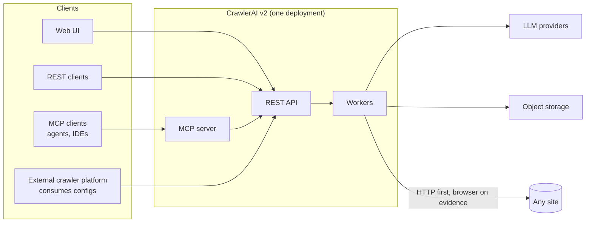
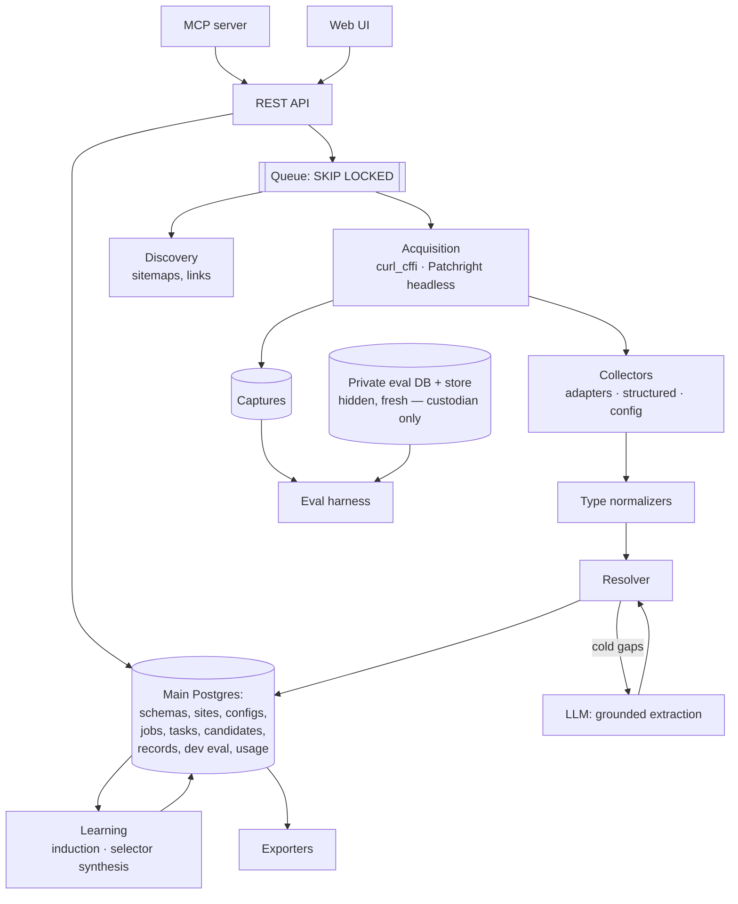

# CrawlerAI v2 — Architecture

Status: design, rev 17, 2026-10-15. No code exists.

**Role of this document.** This is the single design reference. Related documents:
- `OPEN_QUESTIONS.md`: decisions still open.
- `specs/`: implementation specs derived from this document.
- `DECISIONS.md`: the log of decisions agents make during implementation.
- `plans/ACTIVE.md`: current implementation state.
- `../CLAUDE.md`, `ENGINEERING.md` and `../.claude/skills/`: rules, principles and procedures for coding agents.
- `INVARIANTS.md` and `DESIGN.md` (created by SPEC-00): the enforced invariants and the UI design guide. Both are
  derived from this document and never extend it.

If a spec or an implementation decision changes anything decided here, this file is updated in the same change.
Numbers are starting points to confirm on the evaluation sets (§16), not commitments.

**Core and candidates.** This document designs only **core**: what is needed to produce the first honest
measurement or to meet an owner decision. Every other mechanism is a **candidate** (§22). A candidate is listed with
the failure class it would address and the evidence that would admit it, and gets no design until then (C13).

Evidence labels:
- **[verified]**: read in a primary source.
- **[self-reported]**: vendor or author claim.
- **[unverified]**: not checked.
- **[v1]**: observed in the CrawlerAI v1 repo at `08430ca5`.
- **[Invoro]**: observed in the Invoro repo at `e00501a`.

---

## 1. Goals and non-goals

**What it is.** It takes any URL or site and returns clean, normalized, typed records for a schema the caller
chooses, plus an executable per-site config. It is used through a REST API, an MCP server and a web UI. The API shapes are
our own. Commerce and jobs are the first schema presets, not the limit. The
project is open source under AGPL-3.0 (Appendix A #26).

**Users** (Appendix B):
- *config users* (crawl and solution engineers) consume configs for an existing crawler platform;
- *data users* consume records;
- agents use it through MCP.

### Goals

| # | Goal | Measured by |
|---|---|---|
| G1 | **Works on sites nobody tuned against.** | Precision and coverage per field type on the **hidden** and **fresh** sets (§16). The gap between dev and fresh results. |
| G2 | **Precision first.** A wrong published value is worse than a missing one. | Required-field precision ≥ 0.97 on hidden. False publishes on `absent` labels ≈ 0. Wrong-product values = 0. |
| G3 | **Any schema.** Callers define a schema, or describe one in a prompt (§5). | Custom schemas use the same pipeline. Accuracy is claimed per schema only after it has labels. |
| G4 | **Records and executable configs** from one pipeline. | Every exported config is re-executed on held-out pages before release (§12). |
| G5 | **Progressive.** The first call on an unknown site works; repeat calls become deterministic and cheap. | Share of pages served by a config. Time from URL to accepted config. |
| G6 | **Recurring crawls are cheap.** Change detection from day one. | LLM calls per 1k recurring pages ≈ 0. |
| G7 | **Replayable.** Any record can be regenerated from its stored capture. | Replay harness in CI. |

Usage (LLM tokens, browser-seconds, proxy bytes) is counted per job for visibility and runaway budgets. An
estimated LLM cost, from the providers' published prices kept as versioned data, is shown for visibility too
(owner, 2026-10-14). There is no billing (Appendix A #2).

### Non-goals

- Page-type detection. The caller chooses detail or listing (§23).
- Web search and scripted browser actions (Appendix A #21).
- Multi-tenant SaaS machinery: billing, signup, tenancy, user accounts, roles. One deployment serves one
  organization, with API keys.
- Enrichment, product intelligence, knowledge graphs.
- Web-scale crawling. The design point is 5k–10k pages/day, with 10× headroom by adding workers.
- Authenticated or paywalled crawls.
- Anything listed in §22, until it is admitted.

---

## 2. Generalization contract

Both earlier versions worked on the sites they were tuned on and produced garbage on new ones. These rules are
binding. A change that conflicts with them is wrong, even if it fixes a site.

### 2.1 What went wrong (evidence)

| Mechanism | Invoro **[Invoro]** | v1 **[v1]** |
|---|---|---|
| **The quality check was the tuning set** | `TEST_SITES.md`: 253 URLs, no expected values. The loop was: an LLM audits output for those URLs, then another agent fixes each defect. The labeled set the harness pointed to was never committed. | The one labeled set had 82 cases on 79 hosts, and 78 of those were test hosts. The `unseen_domain` partition was never run. Corpus gates were banned. Fixes were judged by case number. |
| **Fixes became global lists** | 309 rule keys and 4,507 entries. Cookie-consent words became variant noise. One retailer's image filenames became a colorway rule. | 8,311 config literals. One title list grew from 15 to 45 entries taken from individual retailer pages. One retailer's search-vendor attribute went into the generic card selectors. |
| **"Literals in config" moved site logic instead of removing it** | 209 retailer-literal lines in 24 non-adapter files; a 25-host currency table. | The same tables were inherited. 36 "platform families", some of them a single company. The genericness test scanned the wrong folder. |
| **Normalization guessed** | `$`→USD. Availability matched by substring order ("unavailable" contains "available"). | `$`→USD (an Argentine store published USD). URL size code `004` published as a size. Seller published as brand. Color guessed from quoted words. |
| **Same field normalized in many places** | — | Currency in 13 files, availability in 12, brand in 14 functions. |
| **Agents optimized visible checks** | About 10 of 15 commits were churn from LOC budgets and bot-review backlogs. | 10 of 23 sampled fixes were site patches presented as generic. 222 tests name a retailer. Zero property tests. |
| **Rules carried forward** | Lists were copied into v1 almost verbatim. | — |

The cause was a feedback loop with **no held-out signal**, combined with fixing one site by adding a rule that runs
on every site.

### 2.2 Rules

| # | Rule | Enforcement |
|---|---|---|
| C1 | **Held-out data is never seen and never fitted.** Splits: dev, hidden, fresh (§16). Hidden and fresh pages, their captures and their site metadata live **only** in a private database and object store (§15), never in the main DB, the repo, logs or CI artifacts (the repo is public, so CI logs and artifacts are too). Agents see only aggregates. Hidden and fresh are never used to fit thresholds, precedence or calibration. Every label is confirmed by a human. | Separate database and store with custodian-only credentials; a protected CI job. |
| C2 | **Generic code encodes standards, types and structure only.** Admissible justifications: a published standard (schema.org, ISO 4217/8601/3166, CLDR, GS1, RFC, HTML, Open Graph), a property of a field type, or a structural regularity of HTML. "Site X does Y" is never admissible. Each generic rule names its justification. | Review. |
| C3 | **No site literals outside site data.** Hostnames, retailer and brand names, and strings copied from pages appear only in the adapter package and in database rows. | CI scan of the whole repo with a domain regex and a reviewed allowlist (standards hosts such as schema.org, package registries, RFC 2606 example names). The scan against hidden and fresh hostnames runs in the protected job, from a secret list, reporting only file and line. |
| C4 | **No lists that grow one incident at a time.** Vocabularies come from versioned external data (CLDR, schema.org). A type vocabulary with no standard (such as availability phrases) lives in its normalizer, is tagged by language, and grows only under the C10 acceptance rule. | Review; PR report. |
| C5 | **A failing site is fixed with data, not code.** Re-run learning (§8.3) or correct the site's config through the API. A PR changes generic behaviour only for a class of failures. | Review. |
| C6 | **Adapters only for multi-tenant platforms**, evaluated on ≥ 3 tenants not used to build them. | Eval report. |
| C7 | **Normalizers decline rather than guess** (§9). No defaults, no host tables, no values from URL codes. Derived values fill only empty fields and carry `derived_by`. | Property tests. |
| C8 | **One module per field type.** | Import-linter independence and forbidden-import contracts, plus review. |
| C9 | **Tests check type properties and replays, not specific sites.** No test is named after a site or asserts one site's output. | C3 scan; review. |
| C10 | **How changes are accepted.** A change is accepted when it **improves dev** and **does not regress hidden** (§16.4). Claims that something *improved* are made only from **fresh** results, never from hidden. Accepting on "hidden improved" would fit hidden slowly through repeated selection. PR comments carry dev deltas and only the hidden pass/fail per field type. Numeric hidden aggregates go only to the custodian. Until labels exist (§21, milestone M), the gate reports `no_baseline` and acceptance rests on tests, replays and review. | CI; PR template. |
| C11 | **Two size checks, no others** (Appendix A #33). Cognitive complexity is at most 15 per function (as SonarSource defines it), a hard check. A file has at most 800 lines, a soft limit: CI warns and never fails. A file past 800 is split along logical boundaries (cohesive modules, field types per C8), never mechanically to meet the number. No other LOC, complexity, coverage or ratchet gates. | Complexity check in CI and `make check`; file-length warning; CI meta-check that refuses any other gate. |
| C12 | **Nothing is copied or ported from Invoro or v1:** code, lists, config, tests, prompts or data (Appendix A #24). | License scan; C3 scan. |
| C13 | **Mechanisms are admitted by evidence.** A mechanism outside core is added only when evaluation results or production outcomes show a class of failures it fixes, and its effect is measured. "It makes sense" and "v1 had it" are not evidence. | §22 register; PR report. |

### 2.3 How v2 handles sites nobody has looked at

The generic layer is small: structured-data standards (§8.1), type normalizers (§9), and grounded per-page LLM
extraction for whatever those miss (§8.4). Site-specific knowledge is learned per site at run time, stored as data
(§8.3), and measured on sites nobody tuned against (§16).

---

## 3. System context



- One deployment, one organization. Projects group sites. Access is by API key.
- REST, MCP and the UI call one service layer; MCP and the UI hold no logic of their own.
- The external platform's config format is unknown (OPEN_QUESTIONS #1). We own a portable config IR (§12) and
  pluggable exporters.

---

## 4. Components



One backend image runs three roles: `api` (REST + MCP over HTTP), `worker` and `scheduler`. Alongside it: one
frontend bundle, Postgres (main plus a private eval database), and object storage (main plus a private root).
There is no Redis and no Celery.

---

## 5. Schemas as data

A **schema** is a row in the database. Code knows about field **types**, never about "price on a product page".

### 5.1 Field types

| Type | Value |
|---|---|
| `text`, `long_text` | string; long text built from main-content extraction |
| `money` | {amount: decimal, currency: ISO 4217}, atomic |
| `enum` | code from a referenced vocabulary (e.g. schema.org `ItemAvailability`) |
| `url`, `image_url` | absolute, canonicalized |
| `identifier` | {scheme: gtin \| isbn \| mpn \| sku \| custom, value} |
| `date`, `datetime` | ISO 8601 |
| `location` | {text, locality, region, country ISO 3166-1 alpha-2, remote_flag}: what the page states (§9) |
| `range` | {min, max, currency or unit, period}; covers salary |
| `count` | non-negative integer, such as a stock quantity (Appendix A #39) |
| `number` | decimal as the page states it, such as a rating value (Appendix A #42) |
| `list<T>`, `object{…}` | nesting, depth ≤ 3 |

Types not in this table are added when a schema needs them, each with its one normalizer (C8).

### 5.2 Schema definition

```jsonc
{
  "name": "commerce_detail", "page_kind": "detail",
  "required_groups": [["sku", "gtin"]],
  "fields": {
    "title":  { "type": "text",  "required": true, "scope": "row",
                "description": "Product name shown to the buyer, without store name", "schema_org": "Product.name" },
    "price":  { "type": "money", "required": true, "description": "Current price, when every variant has the same one",
                "schema_org": "Offer.price+priceCurrency" },
    "availability": { "type": "enum", "vocab": "schema:ItemAvailability", "required": true, "schema_org": "Offer.availability" },
    "sku":    { "type": "identifier", "scheme": "sku",  "schema_org": "Product.sku" },
    "gtin":   { "type": "identifier", "scheme": "gtin", "schema_org": "Product.gtin" }
  }
}
```

- **Required fields.** "Core fields" means fields with `required: true`, plus `required_groups`, where at least one
  field of each group must publish.
- **Scope.** `scope` ∈ {`row`, `page`}, default `row`. On detail pages everything is `row`; on listings,
  `page` fields such as `next_page_url` belong to the page.
- **`description`** is required on every field; LLM roles read it.
- **`schema_org`** is a dotted path from a schema.org type. `+` joins two properties into one atomic value. `|`
  separates alternatives, whose candidates are pooled and resolved as usual (Appendix A #37).
- **Rows.** A `list` of `object` with a `schema_org` path is row-mapped: the path names the row nodes from the
  target, each sub-field maps by its own path within its row, and `key` names the identifier or url sub-fields
  that match one row across sources (SPEC-13).
- **No versions.** One schema per name, edited in place (Appendix A #43). Records and configs reference
  `schema_id`. An edit suspends the schema's active site configs and sends its progressive states back to
  `cold`, so its sites learn again; a job runs with the document it pinned at submit (INV-28).
- Full rules: SPEC-04.

### 5.3 Presets

| Preset | Required fields |
|---|---|
| `commerce_detail` | `title`, `price`, `availability`, `url`, `image_url`; group (`sku` \| `gtin`); `brand` when shown |
| `commerce_listing` | row: `title`, `url`; `price` when shown; page: `next_page_url` |
| `job_detail` | `title`, `company`, `locations`, `description`, `apply_url`, `date_posted` |
| `job_listing` | row: `title`, `url`; `location` when shown; page: `next_page_url` |

"When shown" fields are optional fields in the preset: `required` can't express a condition.
`commerce_detail` has the optional `variants` list, one row per variant with its sku, gtin, price,
availability, url, name and distinguishing attributes (Appendix A #37, SPEC-13), and the optional
`stock_quantity` (count), at the top level and in each variant row (Appendix A #39). The owner added, in place,
optional fields the page states, each mapped to its schema.org property: `description`, `additional_images`,
`color`, `material`, `gender`, `condition` (`itemCondition`), `rating` (`aggregateRating.ratingValue`, a
`number`), `review_count`, `mpn` and `product_id` (`productID`), and `variant_id` in each variant row. Nothing is
derived: no counts or values the page doesn't state (Appendix A #42). A preset changes by editing its file;
`crawlerai schemas sync` updates the stored preset in place.
Optional fields are added when a user needs them (OPEN_QUESTIONS #3). The presets map onto Google Merchant Center
and Google-for-Jobs `JobPosting` required properties **[verified]**. `apply_url` has no direct schema.org property;
its mapping is chosen in SPEC-04.

### 5.4 Custom schemas and prompts

- Custom schemas are created through the API or UI.
- A **prompt** without a schema is turned into a draft schema by LLM role S (§11), from the prompt plus 1–3 sample
  pages. The draft is stored, returned with the results for editing, and reused, so one prompt gives one stable
  schema.
- **Field names** (a request's `schema.fields`, on every run type) are drafted by role S into a schema with exactly
  those top-level fields for the request's page kind, from the names alone, before the job is stored. The same names
  and page kind give the same stored draft. `POST /v1/schemas/draft` returns that draft, so a client shows it for
  editing before the run (Appendix A #41).

### 5.5 Page kind

- `detail`: one primary entity, possibly with nested lists.
- `listing`: rows plus page-level fields.

The caller chooses per request, or per URL pattern in crawls (§13.2).

---

## 6. Data model

There are two Postgres databases:
- **main:** everything below except hidden and fresh evaluation data;
- **private eval:** hidden and fresh pages, their captures and runs, readable only by the custodian role (C1).

Money is `numeric`, and times are UTC. Full DDL, plus implementation plumbing such as run events, record versions,
the queue, and the private eval tables: SPEC-01 and SPEC-03.

| Table | Key columns | Notes |
|---|---|---|
| `project` | id, name | Groups sites. |
| `api_key` | id, hashed_key, label, last_used_at | API and MCP access. |
| `site` | id, project_id, host (exact, lowercased, unique), platform?, fetch_method (`http`, `browser`), proxy_pool?, robots_snapshot, crawl_delay_ms | `fetch_method` is remembered from evidence (§7.1). |
| `schema_def` | id, name (unique), page_kind, fields, required_groups, origin (`preset`, `user`, `prompt_draft`), status | Edited in place (§5.2). |
| `extraction_config` | id, site_id, schema_id, page_kind, version, status (`draft`, `active`, `suspended`), ir (§12), origin (`adapter`, `induced`, `llm_synth`, `operator`), field_status (per field → `corroborated` / `uncorroborated` / `operator` / `suspended`, plus validation yield), validation_report | One `active` per (site, schema, page_kind). |
| `progressive_state` | site_id, schema_id, page_kind, mode (`cold`, `learning`, `active`), pages_extracted | §8.4. A schema edit sends it back to `cold`. |
| `job` | id, project_id, kind (`scrape`, `batch_scrape`, `map`, `crawl`, `extract`, `learn`), request (frozen), schema_id?, status, webhook_url?, engine_version, usage | — |
| `url_task` | id, job_id, url, canonical_url, page_kind?, status, attempts, capture_id, outcome (`extracted`, `partial`, `unchanged`, `links_only`, `blocked`, `shell`, `not_found`, `no_match`, `failed`), last_error | Claimed with `FOR UPDATE SKIP LOCKED`. |
| `url_state` | site_id, canonical_url, etag, last_modified, content_fingerprint, record_fingerprint, last_seen_at, last_changed_at, missing_runs, gone_at? | §14. |
| `capture` | id, site_id, url, fetched_at, method (`http`, `browser`, `api`), status_code, final_url, block_class, object_key, html_sha256, expires_at | Production and dev captures only (§15). |
| `extraction` | id, url_task_id, capture_id, engine_version, config_version?, mode (`adhoc`, `config`), llm_calls | One resolver run. |
| `candidate` | id, extraction_id, entity_ref, field, raw_value, normalized_value, normalize_status (`ok`, `ambiguous`, `invalid`), source_kind (`adapter`, `api`, `jsonld`, `microdata`, `og`, `js_state`, `xhr`, `config`, `llm`, `derived`, `dom`; `derived` marks a page-URL derivation, §10, and no candidate row holds it), independent (bool), locator (§8.1), chosen, reject_reason | Kept 30 days. |
| `record` | id, extraction_id, job_id, site_id, schema_id, entity_key, version, data, field_meta (per field → status, reason, evidence, confidence, calibrated, source_kind, locator, derived_by?), complete (bool), changed_fields, mode, fingerprint, schema_digest, created_at | `data` holds published fields only. `schema_digest`: the document it was extracted with (§5.2). |
| `eval_page` (dev in main; hidden and fresh in private) | id, capture_id, split, schema_id, page_kind, category, labels (value + locator, explicit `absent`), labeler, checker | — |
| `eval_run` | id, engine_version, split, metrics | Hidden and fresh runs export aggregates only. |
| `usage_event` | id, job_id, resource, provider, model_or_pool, quantity, metadata | Visibility and budgets; not billing. |

---

## 7. Acquisition

Acquisition is not where the earlier versions failed (Appendix A #25). Core is the minimum needed to get pages and
record what happened.

### 7.1 Fetch

| Rung | When | Mechanism |
|---|---|---|
| **Adapter / API** | The site's platform has an adapter, or the active config has an `api_recipe` | Direct JSON with `httpx`. First adapters: Greenhouse and Lever (documented public APIs **[verified]**), then Shopify through its Storefront API (Appendix A #46, SPEC-15); others in the order of OPEN_QUESTIONS #2 (Appendix A #17). A page the adapter does not serve falls back to the page rungs. Adapters run only when `CRAWLERAI_ADAPTERS` names them. |
| **HTTP** | Default | `curl_cffi` with Chrome TLS impersonation **[verified: MIT]**. |
| **Browser** | The HTTP result is `blocked` or `shell`, or network capture is needed (§7.2) | **Patchright headless**: the owner's tested configuration (Appendix A #20). The user agent drops `HeadlessChrome`, and client hints stay consistent with it. Network JSON bodies are captured. One navigation, bounded waits. |
| **Proxy** | `site.proxy_pool` is set | The same rungs, through the configured pool. |

- **Outcome classification** uses only status codes and structure, never vendor strings (C2, C3):
  - `not_found`: status 404 or 410;
  - `blocked`: status 401, 403, 407, 429, 451 or 503;
  - `shell`: a 2xx response with almost no visible text and almost no links (thresholds in SPEC-02, confirmed on
    dev);
  - `error`: any other 4xx or 5xx status, a network failure, a timeout, or a size or decode failure;
  - a robots.txt disallow is recorded as `blocked` with reason `robots`, without fetching;
  - `ok`: otherwise.

  Challenge pages served with status 200 are not detected by content. They mostly look like shells and get a browser
  retry, and whatever remains shows up in the outcome mix as evidence for §22. Blocked and shell pages end with
  zero records. The method that worked is remembered in `site.fetch_method` and re-checked periodically against
  HTTP.
- **Politeness.**
  - Per-site rate limit (default 1 req/s).
  - Backoff on 429/503, respecting `Retry-After`.
  - robots.txt honoured by default; operator overrides are recorded on the job.
- **SSRF.** Required, because the API and MCP fetch caller-supplied URLs.
  - Resolve DNS once and connect only to that public IP.
  - Reject private, loopback, link-local, unique-local and metadata ranges on every redirect hop; redirects are
    followed manually.
  - Through a proxy, the IP can't be pinned. The hostname is still checked before each hop, and proxy endpoints
    must be explicitly configured.
- **Limits.** Body size caps, compressed-bomb guard, time budgets.

### 7.2 API-backed pages (Appendix A #4)

1. **Discovery.** Browser fetch with network capture on sample pages. Candidate endpoints are JSON responses
   containing values visible on the page.
2. **Recipe.** A typed `api_recipe` (§12): method, URL template bound from the page URL, the headers proven
   necessary by replay, and a JSONPath map. Templating is deterministic first; LLM role D (§11) runs only when that
   is ambiguous.
3. **Validation.** Replay with `httpx` on held-out URLs; the values must match the browser capture.
4. **Export.** The recipe as data, plus a PHP code hint (OPEN_QUESTIONS #12).

Acquisition candidates (anti-bot identities, cookie handoff, vendor strategies, real Chrome with a behaviour layer,
residential proxies, unblockers, a detection bench) are in §22.

---

## 8. Extraction

**Parse once (Appendix A #31).** A capture body is parsed at most once per parser in a pipeline run. One
`ParsedPage` per capture holds the selectolax tree, the lxml tree (built lazily, and only when an XPath step or
trafilatura needs it), the extracted `<script>` blocks, the cleaned text and the visibility index. Collectors,
cleaned text, content formats, pagination and the config executor all read that object, never the raw body. The
release executor (§12.3) is the one exception: it parses on its own by design, and runs only at release check.

### 8.1 Collectors

```
capture (blocked/shell → stop)
  → adapter / API recipe
  → structured: JSON-LD, microdata (incl. RDFa Lite), Open Graph, embedded JSON state, captured XHR JSON
  → structural DOM: label–value pairs, the main image (detail pages)
  → site config (active extraction_config, deterministic)
  → normalize (§9) → resolve (§10)
  → fields still missing, in cold mode or not covered by the active config → LLM grounded extraction (§8.4)
  → publish / abstain
```

- **Structured collectors map through each field's `schema_org` mapping.** Open Graph maps through a fixed table
  justified by the OGP specification.
- **Embedded JSON state and XHR bodies** have no standard keys. A value becomes a candidate only when:
  - it equals a value from another source kind, in which case it is marked `independent=false` and never counts
    toward `agreed` (§10); or
  - it is visible in the page text (`independent=true`), and the field's type has a syntax its normalizer checks:
    money, enum, date, datetime, location, range, an identifier with a check digit (gtin, isbn), or a url given
    absolute. Any visible string normalizes as text, so text and the other opaque types admit by equality only
    (Appendix A #34).
- **Structural DOM values** (Appendix A #42). On a detail page, a two-cell table row whose first cell heads it and
  a description list's terms with their descriptions (HTML Standard §4.9, §4.4.9) give a candidate when the
  label's words are the field's name or the schema.org property its mapping names; the main region's first
  image outside navigation, headers, footers and asides fills an `image_url` field mapped to `image`. Values must
  be shown. They are independent page values with source kind `dom` and a `dom:` XPath locator, resolved like
  any other with no trust of their own.
- **Locator.** Every candidate carries a locator: `<scheme>:<address>`. Schemes are `jsonld`, `microdata`, `dom`, `meta`,
  `js_state`, `xhr`, `adapter`, `api`, `config`, `text` (character offsets) and `derived` (a page-URL derivation,
  §10: the canonical link or the final URL). The exact format is in SPEC-05.
  Induction (§8.3) generalizes locators.
- **No generic DOM heuristics.** There is no `[class*=price]`, no bare `h1`, no card-selector lists (C2). The only
  DOM selectors are per-site ones in configs (§8.3) and the structural rules above, each named by the HTML
  structure it reads. Repeated-structure and typed value spotting collectors remain a candidate (§22).

### 8.2 Rules

1. **Run every cheap collector.** Skipping only ever means skipping the LLM or the browser.
2. **Shells are not observations.** Blocked, challenge and empty-shell pages end with zero records.
3. **Ownership comes from structure.** A candidate belongs to the entity whose JSON object or DOM subtree contains
   it. When a page carries several primary-type entities, entities nested in `ItemList` or schema.org relation
   properties are excluded, and so are a primary entity's variants (schema.org `hasVariant`: members of a
   `ProductGroup`). Of the rest, the target is the one matching the request, final or canonical URL. If none
   matches uniquely, every field is `conflict` (`intent_ambiguous`), never a guess. An Offer of one of the
   target's variants is the target's, like its own Offers (atomic offers, §10); the variant's other values stay
   the variant's (Appendix A #36).
4. **URL parameter values are never published** unless they are visible on the page.

### 8.3 Learning a site config

Learning runs per (site, schema, page_kind) once **8 pages have been extracted**, meaning pages with outcome
`extracted` or `partial`. Five are the learning sample and at least three are held out for validation. Later pages
join the held-out set.

1. **Induce without an LLM.** For fields where the published candidate's locator follows the same pattern on all 5
   sample pages, generalize it: strip positional indices and keep stable anchors (`id`, `data-*`, `itemprop`,
   unhashed class tokens). Keep a selector only if it selects exactly the published value on every sample page.
2. **Synthesize the rest** (LLM role A, §11). Input: field descriptions, the 5 cleaned sample pages, and the values
   already published on them. Output: a selector or JSONPath map. Up to 3 repair rounds with diagnostics.
3. **Validate on held-out pages.**
   - Exactly one match for single-valued fields, and at least 3 rows on listings.
   - Every value accepted by its type normalizer.
   - The independent release executor (§12.3) reproduces the same values.
4. **Record corroboration per field.**
   - `corroborated`: the config's values match structured-data or adapter values for that field. The comparison
     uses only **comparable** held-out pages, meaning pages that have such a value for the field. At least 3
     comparable pages are required. The values must match on every comparable page while there are fewer than 10,
     and on ≥ 90% from 10 on.
   - `operator`: confirmed or corrected through the API (C5).
   - `uncorroborated`: everything else, including fields with fewer than 3 comparable pages.
   - `suspended`: set by drift (below).

   §16 measures precision separately for each status.
5. **Activate.** The config becomes `active`, and the site enters `active` mode.

**Drift.** Each run of an active config tracks per-field yield and validity against the config's validation report.
If a field drops below it (margins fitted on dev), its status becomes `suspended`: its pages fall back to cold-mode
extraction, and a `learn` job re-runs.

### 8.4 Progressive mode (Appendix A #23)

| Mode | Entered when | Path | Record `mode` |
|---|---|---|---|
| `cold` | A new (site, schema, page_kind), or its schema was edited | Collectors → resolve. Required fields still missing → **LLM role C**: grounded extraction from cleaned page text. Values must be verbatim substrings with offsets and must pass their type normalizer. | `adhoc` |
| `learning` | 8 pages extracted, or an explicit `learn` job | §8.3 runs in the background; pages keep being served in cold mode. | `adhoc` |
| `active` | A config activates | Collectors + config → resolve. Role C only for fields the config doesn't cover. | `config` |

### 8.5 Page content outputs

For `scrape` formats:
- `markdown`: main content via trafilatura **[verified: Apache-2.0]**;
- cleaned `html`, `raw_html`;
- `links`: absolutized;
- `metadata`: title, description, language, canonical, Open Graph, structured-data types present.

All generic; no per-site cleaning (C2).

### 8.6 Listings and pagination

- **Cold listings.** Rows come from structured data (`ItemList`, or several top-level primary-type entities) or from
  role C, which returns rows grounded in page text.
- **Learned configs** carry a row selector and a next-page selector.
- **Pagination.** `rel=next` is a standard and core. A structural rule for numbered page links, matching no
  particular parameter name, is defined in SPEC-05. Infinite scroll goes through §7.2.

---

## 9. Normalization by type

One module per type. Each is a pure function, and the only place its type is handled (C8):

```
normalize(raw, type, context) → Ok(value) | Ambiguous(reason, options) | Invalid(reason)
```

`context` contains only evidence from the page and request: `<html lang>`, `og:locale`, hreflang, currency stated
elsewhere in the page's structured data, the ccTLD resolved through CLDR territory data, and the request's locale
hint. Never host tables (C7).

| Type | Source | Declines when |
|---|---|---|
| money | Unicode CLDR via Babel **[verified: BSD-3]**; `price-parser` (BSD-3) to locate the number | The symbol maps to several currencies (`$` → USD, CAD, AUD, MXN, ARS, …) and context doesn't settle it. The decimal separator is ambiguous. The value isn't positive. |
| enum | schema.org enumerations; language-tagged type vocabularies (C4) | No match. Matching is token-level, never by substring order. Text states a member only when its whole first clause is the member's phrase or name ("Not in stock" declines). |
| date | ISO 8601; `dateparser` (BSD-3) with the page language | Day and month order is ambiguous for the locale. A relative date arrives without a capture time. |
| location | schema.org `Place` / `PostalAddress`; ISO 3166-1 alpha-2 codes as CLDR lists them | Nothing stated, or an `addressCountry` of two letters that is no ISO 3166-1 code. The text and address parts publish as written, whitespace collapsed; a text naming several places or alternatives ("A or B") is one text, never split or parsed into regions (Appendix A #44). A country code only when the page states one, never derived from a name. Remote only from `jobLocationType=TELECOMMUTE` or an explicit remote phrase. |
| range | schema.org `MonetaryAmount` / `QuantitativeValue`; parsed text | Period or currency unresolved. Min > max. |
| count | JSON numbers; schema.org `QuantitativeValue` (`inventoryLevel`); the one number in a text, read by CLDR number symbols | A fraction, a negative number, a range, a unit other than one, no number or two numbers in the text. |
| number | JSON numbers; the one number in a text, read by CLDR number symbols; digits kept as written | No number or two numbers in the text; a minus sign set apart from the digits. |
| identifier | GS1 check digit (GTIN-8/12/13/14), ISBN; `sku`/`custom` stay opaque | Checksum fails. |
| text | Entity and whitespace normalization; trafilatura for long text | Empty, out of length bounds, or a template placeholder (`{{ … }}`). |
| url | WHATWG URL parsing, absolutization | Unparseable, or not http(s). |

- No defaults.
- Derived values fill only empty fields and carry `derived_by`. Each derivation is a named function with a
  standards justification.
- Each type has property-based tests (Hypothesis, test-only).

---

## 10. Resolution and confidence

Three structural stages, then a simple preference rule. A learned ranker is a candidate (§22).

| Stage | Mechanism |
|---|---|
| **Validity** | The type normalizer (§9). Invalid or ambiguous candidates keep a reason and never publish. |
| **Ownership** | From structure (§8.2 rule 3). A candidate not owned by the target entity never publishes. |
| **Intent** | `select_target(request_url, final_url, canonical_url, entities) → entity \| ambiguous`. Ambiguous means `conflict`. |
| **Preference** | **Exact-match types** (money, identifier, enum, date, range, location): if the valid, owned candidates agree after normalization, publish; if they disagree, the field is `conflict` and nothing is published. **Text, url and image:** a per-type source-precedence order in `source_precedence.yaml`, fitted on dev only and measured on hidden. |

**Atomic offers.** Price, currency and availability come from one `Offer`. With several Offers, the target's own
and its variants' (§8.2 rule 3), the field is `conflict` unless they all agree.
An aggregate `lowPrice` is never the current price.

**Variant matrix (Appendix A #37, #44, SPEC-13).** No variant is a default: what varies across variants is
published only in the row-mapped `variants` field, and what is common stays at the top level. The single offer
fields publish only when every Offer agrees (the rule above), whatever variant a page URL names; a top-level `sku`
or `gtin` the target leaves empty takes its variants' value only when every variant states the same one. A
single-variant product publishes at the top level as before. A row-mapped list resolves one row per variant: rows reached from the target, matched across
sources by key, each sub-field resolved by these stages inside its row, with price and availability from one
Offer of the row and evidence per sub-field. Only structured collectors give rows; learning and role C do not.

**Confidence from evidence buckets.** Each published field carries an `evidence` value:
- `adapter`: adapter or API recipe;
- `structured`: one structured source;
- `agreed`: two or more **independent** candidates of different source kinds agree;
- `dom`: one structural DOM value (§8.1);
- `config_corroborated`;
- `config_uncorroborated`: also used for `operator` fields, until labels show they need a bucket of their own;
- `llm_grounded`;
- `derived`: a detail page's `url` derived from the canonical link (RFC 6596) or the final URL when no candidate
  states it (SPEC-05 §4.8), with source kind `derived` and a `derived:` locator naming the derivation.

The field's confidence is the measured precision of its (field type, evidence) bucket on **dev**. Buckets with fewer
than 30 dev labels report `calibrated=false`. Once a bucket is calibrated, a bucket below τ (0.97 for required
fields, 0.95 for optional) abstains.

Uncalibrated buckets publish with the flag set. This is a deliberate trade-off for progressive cold mode (Appendix A
#23): the caller and agents can see that the value is not yet backed by measurement. Hidden and fresh report the
same buckets' precision, which shows whether dev calibration generalizes. Record confidence is the minimum over
required fields, and empty if any of them is uncalibrated.

**Incomplete pages.** When a required field or group doesn't publish:
- a **caller-supplied** URL (`scrape`, `batch_scrape`, `extract`, including URLs expanded from a caller's glob) returns the record with per-field statuses and
  `complete=false`, outcome `partial`. The caller chose the page kind, and every unpublished field says why;
- a **crawl-discovered** URL produces `no_match` and no record (§23).

---

## 11. LLM roles

Every call uses JSON-schema constrained output, has a per-job budget, and is recorded in `usage_event` with a
`prompt_kind`. **Grounding** applies to role C, the only role that outputs values: each value must be a verbatim
substring of the page, with offsets. Roles A, D and S output selectors, request specs and schemas, which are
accepted only through validation by execution (§8.3, §7.2) or by the caller (§5.4).

| Role | When | Output | Model class |
|---|---|---|---|
| **C. Grounded extraction** | Cold-mode gaps (§8.4) | Field values with char offsets from cleaned page text. Ungrounded or type-invalid values are dropped. | Haiku / Flash-Lite-class (≈ $0.0006/page **[verified prices, 2026-10-08]**) |
| **A. Selector synthesis** | §8.3 step 2 | Selector or JSONPath map, never values. ≤ 3 repair rounds. | Sonnet-class (≈ $0.17–0.33/site) |
| **D. API-recipe binding** | §7.2, when templating is ambiguous | A typed request spec, never code | Sonnet-class |
| **S. Schema drafting** | Prompt-only extract; field names (§5.4) | A draft schema | Sonnet-class |

**Why per-page LLM output is not the path for repeat sites:**
- values can be wrong inside valid JSON (83% best value accuracy across 21 models **[verified abstract]**);
- results vary between runs even at temperature 0 **[verified]**;
- there is no exportable config.

Generated selectors came within 1.6 points of per-page extraction with 96% fewer calls **[verified, Brosch et
al.]**. So role C is used only while a site is cold.

**Controls:** flat, cleaned inputs (never raw HTML); acceptance by re-execution; no `exec` of generated code. Page
content is untrusted input to every role.

Candidate roles (adjudication, independent verifier, self-consistency) are in §22.

---

## 12. Config IR and exporters

### 12.1 IR

Everything learned about a site is one portable, versioned, executable IR. The engine runs it, and exporters
translate it, so what we export is what we run.

```jsonc
{
  "ir_version": "1",
  "site": "example.com", "schema": {"name": "commerce_detail"}, "page_kind": "detail",
  "fetch": { "method": "http" },
  "fields": {
    "title": { "steps": [ {"jsonld": "$.name", "when_type": "Product"},
                          {"xpath": "normalize-space(//h1[@data-testid='pdp-title'])"} ],
               "status": "corroborated" },
    "price": { "steps": [ {"xpath": "normalize-space(//*[@class='price-current'])", "post": [{"money": {}}]} ],
               "status": "uncorroborated" }
  },
  "listing": { "row": {"xpath": "//ul[@class='grid']/li"}, "fields": {}, "next": {"xpath": "//a[@rel='next']/@href"} },
  "api_recipe": { "method": "GET", "url": "https://example.com/api/products/{slug}",
                  "params_from_url": {"slug": "regex:/p/([^/]+)"}, "map": {"title": "$.data.name"} },
  "provenance": { "origin": "llm_synth", "validated_on": ["<capture ids>"] }
}
```

- **Steps:** `xpath` (XPath 1.0 only, so PHP `DOMXPath` and `lxml` agree), `css` (compiled to XPath), `jsonld`,
  `jsonpath`, `regex`, `attr`.
- **Post-processing:** type normalizers, `trim`, `regex_replace`, `absolutize_url`.
- In config-only execution, the first valid step wins.
- Site-specific strings are allowed here because the IR is per-site data (C3).

### 12.2 Exporters

- `json`: the IR itself.
- `platform_draft`: XPath 1.0 + regex + named params per field, listing row/next, and `api_recipe` as a PHP code
  hint. This is a draft for an external crawler platform, revised once a sample of its config format exists
  (OPEN_QUESTIONS #1).
- `json_records`, `csv_records`, `markdown`. A `csv_safe` request prefixes `'` to CSV cells a spreadsheet would read
  as a formula (OWASP CSV Injection); the UI's downloads ask for it, and the default export is unchanged (D-0879).
- `json_values`: one item per task, `{url, outcome, records, metadata?}`, where each record holds the schema's
  published fields only (null when not published), with page `metadata` on request; no status columns; jobs with and
  without a schema (SPEC-14).

### 12.3 Release check

A separate minimal executor (lxml XPath 1.0 + regex + JSONPath, no engine logic) runs the exported config on the
held-out pages. A field passes when it reproduces the engine's published values on every held-out page while there
are fewer than 10, and on ≥ 95% from 10 on. Otherwise it is marked `manual` in the export. This proves the export
matches the engine. Correctness is measured in §16, per field status.

---

## 13. API and MCP server (Appendix A #21)

### 13.1 REST API (FastAPI, OpenAPI)

| Endpoint | Purpose |
|---|---|
| `POST /v1/scrape` | One URL → `formats` ∈ {markdown, html, raw_html, links, metadata, records}. Optional `schema` (id, inline, `prompt`, or field names `fields`, §5.4), `page_kind`, `max_age` to reuse a recent capture. Synchronous with a timeout. |
| `POST /v1/batch/scrape` | Many URLs, async. Optional `schema` (id, inline, or `fields`). |
| `POST /v1/map` | URL discovery: sitemaps (robots `Sitemap:`, `/sitemap.xml`, indexes) plus page links. Include/exclude, limit. |
| `POST /v1/crawl` | Async. Start URL, include/exclude globs, depth, limit, `formats`, optional `schema` (id, inline, or `fields`) with page-kind rules per URL pattern. |
| `POST /v1/extract` | Async. URLs (globs expanded through `map`) plus `schema`, `prompt` or `fields` → records, in progressive mode. Returns the drafted schema when a prompt was used. |
| `GET /v1/jobs` | Jobs, newest first, each with its status summary; optional `kind` and `status` filters; cursor-paginated. |
| `GET/DELETE /v1/jobs/{id}`, `GET /v1/jobs/{id}/results`, `GET /v1/jobs/{id}/events` | Status (with whether a cancel was requested), cancel, paginated results (a page output with its task's failure or block reason; or clean `json_values` items, §12.2), server-sent events for progress (from stored run events). A webhook on completion. |
| `/v1/schemas` | Create, read, update in place, delete (retire). `POST /v1/schemas/draft`: the draft of field names for a page kind, for review before a run (§5.4). |
| `/v1/sites/{host}/configs`, `/v1/configs/{id}` (read/update), `/v1/configs/{id}/export`, `/v1/sites/{host}/learn` | Configs, operator corrections (C5), exports, forcing learning. |
| `/v1/records`, `/v1/captures/{id}/replay` | Records with `field_meta`; replay a capture with the current engine. |
| `GET /v1/usage/llm`, `GET /v1/usage/llm/jobs` | LLM calls, tokens and estimated cost for a range of UTC days: totals, per day, per provider, model and prompt kind, and the costliest jobs; per job, cursor-paginated. An estimate for visibility, not billing (§1). |

Every field in a response carries `value`, `status`, `evidence`, `confidence`, `calibrated` and `locator`. Each
record carries `mode` and `complete`.

### 13.2 Crawl frontier

- Sources: sitemaps, page links and pagination.
- URLs are canonicalized and deduplicated, with include/exclude rules and politeness from §7.
- A URL that matches no page-kind rule is crawled for links only (`links_only`) and never extracted.

### 13.3 MCP server

- Official MCP Python SDK (MIT per the SPEC-10 check, 2026-10-12; re-check at adoption); stdio and streamable HTTP transports; API-key
  auth.
- **Tools:** `scrape`, `map`, `crawl_start`, `crawl_status`, `extract`, `extract_status`, `list_schemas`,
  `create_schema`, `get_site_config`, `export_config`. Each is a thin call into the service layer.
- **Output for agents:**
  - markdown is paginated;
  - records show `status` and `confidence`, so an abstention reads as "unknown", not as a value;
  - long jobs return an id plus a status tool.
- **Untrusted content.** Page text is returned as data, and the server never follows instructions found in pages.

---

## 14. Recurring crawls (Appendix A #13)

| Mechanism | Effect |
|---|---|
| Conditional GET (`ETag` / `Last-Modified`). A 304 means `unchanged`. | No download on unchanged pages. |
| Content fingerprint: SimHash-64 of visible text, with scripts, styles and nonces stripped. Only an equal fingerprint (Hamming 0) means unchanged; extraction is skipped. | Skips pages whose visible text did not change, ignoring nonces and whitespace. A one-token change, such as a new price, runs extraction (Appendix A #40). |
| Record fingerprint over normalized required fields. A change creates a new record `version` with `changed_fields`. | Change feed. |
| Listing diff. New URLs are queued; URLs missing for 2 runs get `gone_at`. | Catalog adds and removes. |

A recurring crawl is the caller re-submitting a job. A scheduler is not core. Config drift is handled in §8.3.
Adaptive scheduling and API delta fetches are candidates (§22).

---

## 15. Storage and replay

- **Captures.** One compressed bundle per capture (zstd): the response body, captured network JSON bodies, and a
  JSON sidecar (headers, method, timings, block class). Stored in S3-compatible object storage, or the local
  filesystem in development. Avoid self-hosted MinIO (AGPL).
- **Two stores.**
  - The main store holds production and dev captures.
  - A private root holds hidden and fresh captures and their recorded LLM responses. Only custodian credentials can
    read it (C1).
- **Retention.** Production captures expire after 30 days. Eval captures never expire.
- **Replay.** A pure function: `(capture, engine_version, config, schema) → record`. Live runs and replays
  share one code path. In eval replay, LLM responses are recorded and replayed, so CI needs no network.
- **Public repo.** The repo is public (Appendix A #26). Evaluation data, captures and secrets never enter it.

---

## 16. Evaluation

This is the defence against repeating §2.1. The machinery is built first (L0); labels arrive at milestone M (§21).

### 16.1 Splits

| Split | Who sees cases | Used for | Source |
|---|---|---|---|
| **dev** | Everyone, including agents | Tuning, debugging, and fitting precedence, confidence buckets and drift margins | New pages labeled for v2. Nothing from v1 (C12). |
| **hidden** | Custodian only (OPEN_QUESTIONS #6); others see aggregates | The non-regression gate only (C10), never fitting | Sites absent from dev, stratified by category. A third rotates into dev each quarter and is replaced. |
| **fresh** | Custodian | Improvement claims and the headline number (G1) | Each month, 20–30 sites nobody has seen are sampled (OPEN_QUESTIONS #7), labeled, measured once, then moved into dev. |

**Categories for stratification:**
- `platform_store` (hosted e-commerce platforms such as Shopify);
- `custom_store`;
- `api_backed` (data loaded from XHR/JSON);
- `job_board` (including ATS-hosted);
- `mixed` (one-off sites of any kind).

About 70% detail and 30% listing. DOM-only sites are included on purpose: all 10 accurate v1 results in the 50-site
audit came from JSON-LD pages, so the hard cases were never measured. Custom schemas get their own labels before any
accuracy claim.

### 16.2 Labels

- Two passes: a labeler and a checker. An LLM may pre-fill labels; a human confirms each one. An LLM audit is never
  ground truth.
- Labels are value plus locator, with explicit `absent`.
- Effort: an initial ~300 pages for dev + hidden, ≈ 2–3 engineer-weeks; then ~25 fresh sites × 3 pages per month,
  ≈ 8–12 hours. Labeling is the one part of the process that can't be delegated to agents.

### 16.3 Metrics

- **Per field type, per split:** precision, coverage, abstain rate, false-publish on `absent`, wrong-product rate
  (must be 0).
- **Per evidence bucket and config field status:** precision. This is what admits or rejects candidates in §22.
- **Per category:** zero-touch rate, meaning all required fields published and correct.
- **Generalization gap:** dev minus fresh, per field type.
- **Acquisition:** outcome mix per category.
- **Usage:** LLM calls per 1k pages, by mode.

Hidden and fresh aggregates suppress cells with fewer than 10 labeled fields, so aggregates can't identify individual
cases. Suppression is also complementary: when exactly one cell in a group that sums to a reported total is
suppressed, the next-smallest cell in that group is suppressed too, so no suppressed cell can be recovered by
subtraction.

### 16.4 Harness and gate

- Every merge replays dev and hidden captures offline. Dev results are shown in full. Hidden results are computed in
  the protected job. PR comments show only pass/fail per field type; numeric aggregates go only to the custodian.
- **A merge fails** on a hidden precision drop of more than 0.5 pt on any required field type, or on any
  wrong-product value. At ~150 hidden pages, 0.5 pt is less than one field label, so in practice any new wrong
  publish on hidden fails the gate.
- Exported configs go through the release check (§12.3).
- Pages from redesigned sites are re-captured and re-labeled, never silently dropped.

---

## 17. Observability

- **Usage counters** per job; per-job budgets stop runaway jobs. LLM usage is also shown with an estimated cost
  (§1): tokens priced from versioned price data, unknown where no price applies (C7).
- **Run events** per job (fetch outcomes, mode, LLM calls, abstentions, task failures with their reason, drift
  suspensions) are stored in Postgres and streamed over SSE.
- **Metrics** (OpenTelemetry): pages/min, fetch outcome mix, mode mix, abstain rate, queue depth.

---

## 18. Security

- **Access.** API keys: hashed, revocable, rate limited before any DB lookup. The web UI never asks for a key: whatever serves
  it (today the dev proxy) attaches the bearer key from its own environment (`CRAWLERAI_UI_API_KEY`), so the key never
  reaches the browser. Anyone who can reach the UI can use the API through it, so the UI is served on localhost or a
  private network only (Appendix A #38). No cookies, no sessions, no CSRF surface.
- **SSRF** (§7.1): fails closed and is re-checked on every redirect hop.
- **Secrets** come from environment or a secret store, never the repo, and are redacted in logs.
- **Generated artifacts are data.** Selectors, recipes and schemas run in our interpreter. We never `exec` LLM
  output.
- **MCP.** Page content is untrusted, and prompt injection is expected (§13.3).
- **Supply chain.** Lockfiles, an SBOM, and a dependency license scan denying AGPL, GPL, SSPL and non-commercial
  licenses. The project itself is AGPL-3.0. Keeping dependencies permissive preserves the owner's option to
  license it differently later (Appendix A #26).

---

## 19. Tech stack

| Layer | Choice | Notes |
|---|---|---|
| Language | Python 3.12, TypeScript | Appendix A #16 |
| API / MCP | FastAPI + pydantic v2; official MCP Python SDK | — |
| DB / queue | PostgreSQL 16; a thin `FOR UPDATE SKIP LOCKED` loop | 10k pages/day ≈ 0.1 tasks/s |
| HTTP | `curl_cffi` **[verified: MIT]**; `httpx` | — |
| Browser | Patchright **[verified: Apache-2.0]**, headless | Owner-tested |
| HTML | `selectolax` **[verified: MIT]**; `lxml` (BSD) for XPath 1.0 | lxml matches PHP DOMXPath |
| Normalization | Babel / CLDR (BSD-3), `price-parser` (BSD-3), `dateparser` (BSD-3), `trafilatura` **[verified: Apache-2.0]** | Standards over lists (C4) |
| LLM | Provider-agnostic thin client with JSON-schema outputs | Two providers (OPEN_QUESTIONS #5) |
| Frontend | Vite + React + TypeScript + **HeroUI** (built on React Aria) | Appendix A #27; version in SPEC-00 |
| Tests | pytest, Hypothesis (test-only), import-linter; Vitest | C8, C9 |
| Deploy | Docker, one image with three roles; Postgres; object storage | — |

Tooling details (package managers, linters, type checker, migrations) are in SPEC-00, and the choices are recorded
in `DECISIONS.md`.

**Rejected as the engine:**
- Scrapy (lock-in);
- Crawl4AI / ScrapeGraphAI (would own our pipeline);
- Stagehand (per-page LLM extraction);
- Zyte / Diffbot extraction (closed, per-page, no exportable config);
- pretrained DOM transformers (GPU, no calibration).

Also excluded by license: nodriver and zendriver (AGPL **[verified]**), selenium-driverless (non-commercial),
MinIO (AGPL).

---

## 20. Prior versions

v2 is built from scratch (Appendix A #24). No code, lists, config, tests, prompts or data are ported (C12). When a
candidate from §22 is admitted, its design may *read* Invoro or v1 to learn what was tried. The mechanism is then
re-derived from standards and evidence; nothing is copied.

**Must not reappear**, whatever form it takes:

| Pattern | Seen in |
|---|---|
| Generic DOM selectors per field (`[class*='price' i]`, bare `h1`, card-selector lists) | Both |
| Noise, stop-word or phrase lists grown from observed pages | Both (4,507 and 8,311 entries) |
| Host-keyed tables: currency, brand fallbacks, "platform families" of one company | Both |
| Defaults that invent values (`$`→USD, size from URL code, seller as brand, color from title) | Both |
| Several modules normalizing the same field | v1 |
| Root/entity selection by additive weights; multiple rollup passes re-deciding fields | v1 |
| An LLM audit of the tuning sites used as the quality signal | Invoro |
| Tests named after sites; regression suites pinned to one run's defects | Both |
| LOC or complexity gates driving file splits | Both (v2 keeps one complexity limit and a non-failing file-length warning, C11) |

---

## 21. Build order (core only)

Labeling is deferred until the crawler works end to end (Appendix A #29). Layers L0–L4 are built and accepted on
**functional** criteria: tests, property tests, replays of stored captures, and spec acceptance criteria. Every
claim about accuracy waits for milestone **M**. The measurement machinery itself is still built first, so M only
needs labels, not code.

| Layer | Builds | Done when |
|---|---|---|
| **L0 Foundations and measurement machinery** | Repo foundations (SPEC-00); persistence and storage including the private eval store; eval splits with custodian access; labeling tool; replay; metric report and protected job (a placeholder until M); CI checks; HTTP fetch | Replay is deterministic on stored captures; the labeling tool works; the private store is unreadable with app credentials |
| **L1 Extraction** | Schema registry and presets; type normalizers for preset types; Patchright browser on evidence; Greenhouse + Lever adapters; structured collectors; resolver with evidence buckets; role C cold extraction; role S; `scrape` endpoint with records and markdown | Spec acceptance criteria pass on synthetic fixtures and unlabeled dev captures; every published field carries evidence and `calibrated=false` |
| **L2 Configs and progressive mode** | Config IR and executors; induction; role A synthesis; validation and corroboration status; progressive state; drift suspension; API-backed pages with role D; `json` and `platform_draft` exporters | A dev-capture site reaches `active` with a validated config; release check passes |
| **L3 API and MCP** | `map`, `crawl`, `extract`, batch, jobs, SSE, webhooks; MCP server | Every endpoint works through REST and MCP on dev captures; SSRF tests pass |
| **L4 Recurring** | Conditional GET, content and record fingerprints, listing diff | Unchanged pages skip extraction; record versions carry `changed_fields` |
| **M Measurement** (owner-led, once the crawler is usable) | Dev labels from the owner's review of crawler output; hidden and fresh drawn under the rule below; first calibration and `source_precedence` fit on dev; protected gate switched on | Precision and coverage per field type, evidence bucket and config status published for dev, hidden and the first fresh sample; wrong-product = 0 |

**Keeping a hidden set possible (C1).** Every site that development touches (in the main DB `site` table, in dev
captures, or in debugging) is dev. When M starts, hidden and fresh sites are drawn only from hosts in none of
those places. Sites the owner reviews and corrects while building dev labels are dev too, never hidden. This is
the one rule that stops the deferral from repeating §2.1.

**Before M:**
- confidence is `calibrated=false` everywhere (§10);
- precedence uses the spec's initial order;
- drift margins use their defaults;
- the protected job passes as `no_baseline`.

The engine works, but accuracy is unknown. Nothing claims otherwise, in docs, PRs or UI.

There are no pre-planned hardening layers. After M, work comes from §22 candidates admitted by evidence. The specs
in `specs/` follow this order.

---

## 22. Candidates register

These are not designed and not built. Each is admitted (C13) only when the stated evidence appears, and its effect
is measured after it is added.

| Candidate | Would address | Admitted when |
|---|---|---|
| **Learned, calibrated ranker** (gradient boosting, Platt/isotonic, conformal routing) | Wrong choices among valid, disagreeing candidates | Precedence or `conflict` decisions cause a material share of hidden errors or lost coverage. |
| **LLM adjudication** among conflicting candidates | `conflict` abstentions on resolvable cases | The `conflict` rate on hidden required fields is material, and labels show one candidate was right. |
| **Independent verifier** for configs | Wrong selectors that validate against themselves | Hidden precision of `uncorroborated` config fields is below τ, and they are a material share of fields. |
| **Self-consistency sampling** for role C | LLM value errors | Hidden precision of the `llm_grounded` bucket is below τ. |
| **Generic structural DOM collectors** (repeated structure, label–value pairs, typed value spotting) | Cold-mode cost or coverage on DOM-only sites | Role C cost or coverage on DOM-only fresh sites misses target, and dev shows the collector would help. **Label–value pairs and the main image admitted 2026-10-16** by the owner from the reference eval (Appendix A #42); repeated structure and typed value spotting are not. |
| **More platform adapters** (Workday CXS, iCIMS, ADP, Oracle CX; Shopify admitted, Appendix A #46) | Coverage or cost on those platforms | Results for the platform fall short through the generic path, or volume justifies it (OPEN_QUESTIONS #2). |
| **Variant-matrix handling** | Per-variant price and availability; the multiple-Offer `conflict` | **Admitted 2026-10-15** by the owner ahead of labels (Appendix A #37); designed in SPEC-13. |
| **Anti-bot measures**: allowlisting program, cookie handoff, vendor strategies, real Chrome with a behaviour layer (Appendix A #20 owner note: no Patchright on real Chrome), residential proxies, unblockers, CAPTCHA handling, detection bench | Blocked pages | The `blocked` or `shell` outcome rate for a category is material. The cheapest measure that fixes the blocked class is admitted first. |
| **Recurring schedule storage** | Callers having to re-submit | Recurring volume makes re-submission a burden. |
| **Review queue UI** beyond labeling and config correction | Operator throughput | Operators correct configs often enough that the API and config view slow them down. |
| **Adaptive recrawl schedule; API delta fetches** | Recurring cost | Recurring volume makes fetch cost material. |
| **GMC feed and job XML exporters** | Feed delivery | A user asks (OPEN_QUESTIONS #4). |
| **Site health dashboard, alerts** | Operations | Production use starts. |
| **WARC capture format** | Interoperability with archive tools | Someone needs pywb or WARC output. |
| **Web search; browser actions; authenticated crawls** | Scope | The owner decides (Appendix A #21). |

---

## 23. Deferred: page-type gate

Out of scope (Appendix A #5, #10).

- **Risk.** v1 published records from search, terms-and-conditions and advice pages submitted as detail URLs (4 of
  17 runs in a 50-site audit). `crawl` + `extract` raises this risk.
- **What v2 does instead:**
  - page-kind rules per URL pattern;
  - URLs that match no rule are only crawled for links;
  - ownership and intent stages;
  - `no_match` for crawl-discovered pages whose required fields don't resolve;
  - `complete=false` with explicit statuses for caller-supplied pages.
- **Extension point.** One optional stage before the collectors, with outcome `wrong_page_type`.

---

## Appendix A. Owner decisions

Original decisions are dated 2026-10-08. Later amendments override them. Decisions agents make during
implementation go in `DECISIONS.md`, not here.

| # | Topic | Decision |
|---|---|---|
| 1 | Users | Data users (records/CSV) and config users (XPath/regex + params for an existing crawler platform, plus code hints). |
| 2 | Hosting and cost | No billing, invoicing or multi-tenant auth. Usage stays visible. |
| 3 | Scale | ~5k–10k pages/day, mostly the same sites with different URLs. |
| 4 | API-backed sites | Pages backed by XHR/JSON APIs are a first-class path. |
| 5 | Listing vs detail | The user decides; no automatic page-type routing. |
| 6 | Candidate resolution | The most critical area (§10). |
| 7 | Schema | Schemas are data; commerce and jobs are presets. |
| 8 | LLM role | "Never on the main path" is not a constraint; choose on accuracy and cost. |
| 9 | LLM cost | No abstract cap; usage stays visible. |
| 10 | Page-type gate | Out of scope. |
| 11 | Target sites | Mostly customer-owned sites (allowlisting possible); some competitor sites. |
| 12 | Fetching | HTTP first; browser only on evidence. |
| 13 | Recurring crawls | Change detection from day one. |
| 14 | Raw capture | Compressed captures for replay: 30 days in production, forever for eval. |
| 15 | Scope | An MCP server and a public API are required. Enrichment, intelligence and knowledge graphs are not. |
| 16 | Language | Python backend, TypeScript frontend. |
| 17 | Jobs | ATS adapters first, HTML second. |
| 18 | Location | GitHub `Cube-27/CrawlerAIv2`. |
| 19 | Fallback use | Internal use or open source. |
| 20 | Browser | **Patchright headless** is the browser; the owner tested it and it works. Owner notes for any future anti-bot candidate: Patchright makes real Chrome worse; real Chrome needs human-like behaviour, not Patchright. Camoufox was rejected. |
| 21 | API and MCP | Scrape, map, crawl, and extract with a schema or prompt. Our own API shapes. No web search, no browser actions. |
| 22 | Generalization | The target is clean, normalized data from any site, for any schema; §2 is binding. |
| 23 | Ad-hoc extraction | Progressive mode (§8.4). |
| 24 | Codebase | Build from scratch. No porting from v1, including acquisition. |
| 25 | Scope discipline | Acquisition is not the main concern. Only core is designed; everything else is a candidate admitted by evidence (C13). |
| 26 | License and visibility (2026-10-12) | The repo is **public**, licensed **AGPL-3.0**. Documents name no customer or prospective buyer and contain no business terms. |
| 27 | Frontend (2026-10-12) | Vite + React + TypeScript + HeroUI (open source, React Aria based). |
| 28 | Autonomous implementation (2026-10-12) | Implementation runs through orchestrated coding agents with minimal owner involvement. Agents record their decisions in `DECISIONS.md` and state in `plans/ACTIVE.md`. Changes to this document are escalated to the owner. |
| 29 | Labeling deferred (2026-10-12) | No labeled sets before the crawler works. L0–L4 are accepted on functional criteria; measurement is milestone M (§21), started by the owner from reviewing crawler output. Hidden and fresh are later drawn only from sites development never touched. |
| 30 | Hidden/fresh privacy answers (2026-10-13) | Hidden and fresh aggregates use complementary suppression as well as the 10-field minimum cell (§16.3). Hidden and fresh pages are labeled only through an instance of the app on the custodian machine with a private backend, never deployed. |
| 31 | Parse once (2026-10-13) | A capture body is parsed at most once per parser per pipeline run; every consumer reads one shared `ParsedPage` (§8). The release executor is the only exception. |
| 32 | Operational invariants (2026-10-13) | No layer after resolution changes a published value; a job pins its settings at submit; cookies stay inside one fetch; untrusted bodies are bounded; one task's failure never fails another; forwarded headers only from trusted proxies and no API keys created at startup (INV-27–INV-32). |
| 33 | Complexity and file length (2026-10-13) | Cognitive complexity of at most 15 per function is a hard check in CI and `make check`, for backend, tools and frontend code. 800 lines per file is a soft limit: CI warns, never fails, and a file past it is split by meaning, not to meet the number. Coverage gates and ratchets stay forbidden (C11). |
| 34 | Embedded-state admission (2026-10-14) | A visible `js_state` or `xhr` value with no other candidate to equal is admitted only for field types with a checkable syntax (§8.1); opaque types such as text and sku admit by equality only. Accuracy Q2, option (a). |
| 35 | `brand` optional (2026-10-14) | "Brand is not that important": preset `commerce_detail` version 2 makes `brand` optional (§5.3). A page without a brand is complete, and the gap rule no longer asks role C for it. |
| 36 | Variants are members (2026-10-15) | A primary entity's `hasVariant` variants are members of it, not candidates for the target, and their Offers are the target's under the atomic-offer rule (§8.2 rule 3, §10). Step A of the variants proposal; variant-matrix handling itself (§22) is admitted separately and specified in SPEC-13. |
| 37 | Variant matrix (2026-10-15) | Variant-matrix handling (§22) is admitted now, ahead of labels. `commerce_detail` version 3 adds an optional `variants` list from structured data; sub-fields of a `list` of `object` map by their own `schema_org` paths; the single price, availability, sku and gtin publish only when every variant agrees (amended 2026-10-16, #44: no URL-named default variant). No platform JSON adapter (superseded for Shopify by #46). Variant labels and their scoring are specified, not built (SPEC-13). |
| 38 | Playground UI (2026-10-15) | The UI is one playground: a mode switch (Scrape, Batch, Crawl, Map, Extract), a command bar with the primary action at the top, settings in an inline options panel with Advanced collapsed, and output on the same page. No pop-up windows for runs. Clean JSON is the main output: schema fields only, metadata only when asked for. Batch and crawl show a running table with each page's JSON in a side drawer, and plain-language live activity. The UI never asks for an API key; the server that serves it attaches one (§18). `/` opens the playground. SPEC-14. |
| 39 | Availability and stock quantity (2026-10-16) | Availability and stock quantity are separate fields. Availability stated in words or codes ("in stock", "instock", "In stock (5 available)") normalizes to the schema.org `ItemAvailability` member, the one availability convention in the repo; the stock quantity is its own `count` field (5). `commerce_detail` version 4 adds the optional `stock_quantity`; variants carry availability and stock quantity when the page states them per variant, otherwise the page's values publish. D-0782. |
| 40 | Derived page URL; unchanged pages (2026-10-16) | A detail page's `url` derived from the canonical link or the final URL publishes with source kind `derived`, a `derived:` locator and its own `derived` evidence bucket, calibrated like any other (§6, §8.1, §10). INV-22 holds as written. D-0355, option (a). Only an equal content fingerprint (Hamming 0) means a page is unchanged (§14); D-0665, option (b). An opt-in `csv_safe=true` results parameter quotes formula-like CSV cells, and the UI's Export CSV sends it; default output is unchanged (§12.2). D-0879, option (a). |
| 41 | Additional fields (2026-10-16) | Field names typed in the UI become a `fields` request member on every run type (scrape, batch, crawl, extract). The server drafts a typed schema from the names with role S, for the request's page kind; the UI shows the draft for editing before the run (D-0810, option a). |
| 42 | Reference-eval coverage (2026-10-16) | Label–value pairs and the main image, from the §22 structural DOM candidate, are admitted: source kind `dom`, a `dom:` locator and a `dom` evidence bucket (§6, §8.1, §10). `commerce_detail` gains optional schema.org-mapped fields the page states, edited in place, and a `number` field type for `rating` (§5.1, §5.3, §9). Extract, never enrich. D-0955–D-0957. |
| 43 | Greenfield: no versioning; extract, not enrich (2026-10-16) | "Nobody asked for [schema versioning] and there are no users"; "migration and versioning all should be greenfield always for now; if there is a use case we will implement later." One schema per name, edited in place; an edit sends its learned configs back to learning (§5.2). One baseline migration; the database is recreated, never migrated with data steps. Record versions, draft and active configs and `engine_version` stay: they are features. GeoNames is dropped: "our job is to extract page data, not change it"; a location publishes what the page states (§9). |
| 44 | Owner answers (2026-10-16) | **Variants:** "no default — all variant schema goes into variants and common schema stays out of variants, simple." A multi-variant product's values that vary (price, availability, stock quantity, sku, gtin, variant attributes) publish only in `variants` rows; a top-level field publishes only a value every variant shares. No variant the page URL names is selected (§10; D-0945). **Job location:** "just display whatever is written in jobs location." The location text publishes as written, whitespace collapsed, with no macro-region parsing or "or" split; structured parts only where the page states them structurally (§9; D-0946 class 11). **Provider refusal:** a provider's refusal of a request has its own reason and problem type, `llm_refused` (502), distinct from `llm_unavailable` (D-1009, option a). |
| 45 | Playground options popover (2026-10-16) | Owner, after #214: the playground's settings open from the command bar's Options button in a popover, with every setting shown at once in a compact grid and no nested Advanced section; the command bar sits centred under a centred mode switch. This replaces #38's "inline options panel with Advanced collapsed"; the rest of #38 stands. Opening the popover moves nothing on the page. SPEC-14 §4.2. |
| 46 | Shopify adapter (2026-10-16) | The Shopify platform adapter is admitted from §22 "More platform adapters". It reads storefront product and collection pages through the documented Storefront API (tokenless, MoneyV2 prices with their currency), confirms the platform by the documented `X-Shopify-API-Version` response header, and maps the answer to schema.org shapes, so variants give rows under the variant rules (#44). Every adapter's unserved page falls back to the page rungs. Adapters are off until `CRAWLERAI_ADAPTERS` names them. SPEC-15. |

---

## Appendix B. User requirements

- **Config users** set up crawls in an existing crawler platform written in PHP. They need:
  - XPath 1.0 strings, regex and named parameters per field;
  - listing row and next-page selectors;
  - for API-backed sites, a request recipe plus a code hint.

  Configs must be validated by execution before handover.
- **Data users** need final records as CSV/JSON for common commerce and job sites, without configuring anything.
- **Acceptance.** Precision and coverage are reported separately, never as one "accuracy" number counting filled
  fields. Each phase has one zero-touch target, measured on fresh sites (OPEN_QUESTIONS #3).
- **Known hard cases:** behavioural bot challenges, CDN edge blocking, IP rate limits. No authenticated crawls.

---

## Appendix C. Evidence base

Condensed from the 2026-10-08 research notes, which are not in the repo.

**Resolution and confidence:**
- **Pinterest 2025** (arxiv.org/html/2508.01096v1), 1,015 unseen domains **[verified]**:
  - schema.org precision: sale price 0.90, title 0.95, image 0.66;
  - an XGBoost ranker over render features reached 0.97 price precision.

  Structured data is strong but imperfect; a learned ranker is the known upgrade (§22).
- **Klarna** (arxiv.org/html/2111.02168v4): an LLM chooser added +16.8 pp over a weak ranker. Pinterest saw no gain
  over a strong one **[verified]**.
- **Wrapper induction across sibling pages:** Dalvi et al. VLDB 2011 (arxiv 1103.2406); Ceres (arxiv 1804.04635)
  **[verified]**.
- **Calibration:** Platt below ~1k labels, isotonic above (Guo et al. ICML 2017; scikit-learn docs) **[verified]**.
  Split-conformal extraction at α=0.02 gave 98.3% coverage with 70% singleton sets (Rombach & Mehdiyev, IJDAR 2026)
  **[verified]**.
- **Static benchmarks overstate live accuracy** by ~8 points (LiveWeb-IE, arxiv.org/html/2603.13773)
  **[verified]**.
- **WDC 2024-12:** Product markup on 3.3M hosts; JobPosting on 63k hosts **[verified]**.
- **v1's tie-breaking audit:** none of 16 defects was a tie between valid candidates. All were validity, scope,
  intent or absence failures. This is why the structural stages come first.

**LLM role:**
- **ScrapingBee** (2026-09-07): validated selector maps reached 96/96 fields at 2 ms/page vs 87/96 for a per-page
  LLM **[verified]**.
- **Brosch et al. DATA 2025** (arxiv.org/html/2506.21585v1): generated extractors came within −1.6 pts of per-page
  extraction with 95.8% fewer calls; per-page extraction hallucinated attributes **[verified]**.
- **OmbuLabs:** 30–40% first-attempt selector failure, hence validation and repair **[verified, anecdotal]**.
- **Structured Output Benchmark** (arxiv 2604.25359): 83% best value accuracy **[verified abstract]**.
- **Thinking Machines:** temperature 0 is not reproducible **[verified]**.
- **NEXT-EVAL** (arxiv 2505.17125): flat inputs hallucinate least **[verified abstract]**.
- **LangExtract** (github.com/google/langextract): char-offset grounding, Apache-2.0 **[verified]**.
- **Prices, 2026-10-08, per 1M tokens** **[verified]**: Gemini 2.5 Flash-Lite $0.10/$0.40; Claude Haiku 5.5
  $0.10/$0.50; Claude Sonnet 5.5 $2/$10. Per-page Flash-Lite-class at 10k pages/day ≈ $186/month.

**Browser:**
- **Patchright:** Apache-2.0, PyPI 1.63.0 (2026-09-20) **[verified]**.
- **Runtime.enable detection:** the classic probe reportedly stopped working in Chrome after V8 changes in May 2025
  (blog.crawlex.net) **[self-reported]**. Other sources dispute this **[self-reported]**.
- **nodriver / zendriver:** AGPL-3.0 **[verified]**.
- **v1 50-site audit:** 11 of 22 listing failures were WAF 403s; 5 were JS shells.

---

## Revision log

| Rev | Date | Change |
|---|---|---|
| 1 | 2026-10-08 | Initial architecture. |
| 2 | 2026-10-08 | Page-type gate deferred; wrong-product metrics; build order with an MVP cut. |
| 3 | 2026-10-12 | Consolidation: generalization contract, schemas as data, type normalizers, per-site learning, progressive mode, API + MCP, three eval splits. |
| 4 | 2026-10-12 | Core/candidate pass (C13); acquisition cut to core; no porting from v1; review fixes (fitting on dev only, protected scan, sample sizes, evidence buckets). |
| 5 | 2026-10-12 | **Spec review folded in, repo made public.** <br>• Hidden and fresh data live only in a private DB and store (C1, §6, §15). <br>• Acceptance is dev improvement plus hidden non-regression; improvement claims come from fresh only (C10); small-cell suppression. <br>• Locator defined (§8.1); `required_groups` and `scope` (§5.2); `independent` flag so `agreed` can't count a value agreeing with itself (§8.1, §10). <br>• Block classification by status and structure only (§7.1); SSRF behaviour through proxies stated. <br>• Partial records for caller-supplied URLs, `no_match` for crawl-discovered ones (§10). <br>• Grounding scoped to role C (§11). <br>• Learning counts extracted pages; small-n thresholds (§8.3, §12.3). <br>• Plumbing named: `learn` job kind, `links_only`/`partial` outcomes, record versions, `gone_at`, stored run events. <br>• UI auth by bearer API key, no CSRF (§18). <br>• Repo public under AGPL-3.0: customer names and business terms removed; Appendix B rewritten as anonymized user requirements; eval categories renamed to generic ones; the platform exporter renamed `platform_draft`. <br>• Appendix A #26–#28 added. <br>• Consistency pass: comparable-page rule and floor of 3 for corroboration; `suspended` field status; `schema_version` on `progressive_state`; `operator` fields use the `config_uncorroborated` bucket; glob-expanded `extract` URLs count as caller-supplied; `error` class and robots outcome defined; role C also fills fields an active config doesn't cover; hidden numbers stay with the custodian (PR comments show pass/fail only); PHP-only code hints. |
| 6 | 2026-10-12 | **Labeling deferred** (Appendix A #29). §21 rewritten: L0–L4 accepted on functional criteria, accuracy claims moved to milestone M; rule for drawing hidden and fresh from untouched sites; C10 notes the `no_baseline` period. |
| 7 | 2026-10-13 | **Owner answers** (Appendix A #30). §16.3: complementary suppression for hidden and fresh aggregates (D-0234, OPEN_QUESTIONS #16). |
| 8 | 2026-10-13 | **Parse once** (Appendix A #31, owner). §8: one `ParsedPage` per capture, shared by every consumer (INV-26). Appendix A #32: operational invariants INV-27–INV-32 (owner-selected). Comparisons with a named hosted crawler removed (owner). |
| 9 | 2026-10-13 | **C11 amended** (Appendix A #33): a hard cognitive-complexity limit of 15 per function and a soft, warning-only limit of 800 lines per file; no other size, coverage or ratchet gates. INV-18 reworded; SPEC-00 §4.6 updated. |
| 10 | 2026-10-14 | **`GET /v1/jobs`** (owner approval, D-0700): §13.1 lists jobs, newest first, with optional `kind` and `status` filters and cursor pagination, for SPEC-12's jobs table. SPEC-10 and SPEC-12 updated. MCP tools unchanged (§13.3). |
| 11 | 2026-10-14 | **Estimated LLM cost** (owner approval, 2026-10-14). §1: an estimated LLM cost is shown for visibility; still no billing. §13.1: `GET /v1/usage/llm` and `GET /v1/usage/llm/jobs`. §17: usage shown with its estimated cost. Prices are versioned data under `backend/data/llm/` (C4); a call without a price has an unknown cost (C7). SPEC-06, SPEC-10 and SPEC-12 updated. MCP tools unchanged (§13.3). |
| 12 | 2026-10-14 | **Task failure reasons** (owner approval, D-0745 option a). §13.1: a job's summary carries `cancel_requested`; a page output carries its task's `last_error`. §17: a `task_failed` run event, with the task's reason, when a task fails for good. All additive. SPEC-10 and SPEC-12 updated. MCP tools unchanged (§13.3). |
| 13 | 2026-10-15 | **Embedded-state admission** (owner approval, accuracy Q2 option a; Appendix A #34). §8.1: a visible `js_state` or `xhr` value is admitted on its own only for field types with a checkable syntax; opaque types admit by equality only. SPEC-05 §4.5 updated. |
| 14 | 2026-10-15 | **`brand` optional** (owner approval, accuracy Q1; Appendix A #35). §5.3: `commerce_detail` version 2 lists `brand` as shown-when-present. SPEC-04 §4.2 updated. |
| 15 | 2026-10-15 | **Variants are members** (owner approval, variants proposal step A; Appendix A #36). §8.2 rule 3: `hasVariant` variants are excluded from target candidates and their Offers are owned by the target; §10 atomic offers count them. SPEC-05 §4.6 and §4.8 updated. |
| 16 | 2026-10-15 | **Variant matrix** (owner admission; Appendix A #37). §5.2: `\|` alternatives in `schema_org`, row-mapped `list` of `object` fields with `key`. §5.3: `commerce_detail` version 3 adds optional `variants`. §10: selected variant by URL identity, variant fill, per-row resolution. §22: the candidate is marked admitted. SPEC-13 added; SPEC-04 and SPEC-05 point to it. INV-33–INV-36. |
| 17 | 2026-10-15 | **Playground UI and server-side key** (owner; Appendix A #38). §18: the UI never holds an API key; the server that serves it attaches one. §12.2: `json_values` record export. SPEC-14 added; SPEC-12 points to it for the Connect screen, job dialogs, Overview and Scrape layout. |
| 18 | 2026-10-16 | **Availability and stock quantity** (owner approval, D-0782; Appendix A #39). §5.1: a `count` field type. §5.3: `commerce_detail` version 4 adds optional `stock_quantity`, also per variant. §9: a `count` row; enum text states a member only through its whole first clause. SPEC-04 and SPEC-13 updated. |
| 19 | 2026-10-16 | **Owner answers of 2026-10-16** (Appendix A #40). §6, §8.1, §10: a derived page URL publishes with source kind `derived`, a `derived:` locator and a `derived` evidence bucket (D-0355); migration 0019. §14 row 2: only Hamming 0 means unchanged (D-0665); SPEC-11 updated. §12.2: an opt-in `csv_safe` CSV export, a `GET /v1/jobs/{id}/results` parameter (D-0879); SPEC-08 and SPEC-10 updated, INV-27 noted. SPEC-05 §4.3, §4.8 and §4.9 updated. MCP tools unchanged (§13.3). |
| 20 | 2026-10-16 | **Additional fields** (owner approval, D-0810 option a; Appendix A #41). §5.4: `schema.fields` is drafted by role S from the names alone, one stored draft per names and page kind. §11: role S drafts field names. §13.1: `fields` on scrape, batch, crawl and extract; `POST /v1/schemas/draft`. SPEC-06 §4.5, SPEC-07 §4.4, SPEC-10 §4.3–4.6 and SPEC-14 §4.10 updated. |
| 21 | 2026-10-16 | **Reference-eval coverage** (owner; Appendix A #42). §5.1: a `number` field type. §5.3: `commerce_detail` optional fields the page states. §6, §8.1, §10: structural DOM values (label–value pairs, main image) with source kind `dom` and a `dom` bucket; migration 0020. §9: a `number` row. §22: the two collectors marked admitted. SPEC-04, SPEC-05 and SPEC-13 updated. |
| 22 | 2026-10-16 | **Greenfield: no versioning; GeoNames dropped** (owner; Appendix A #43). §5.2: one schema per name, edited in place; an edit suspends its active configs and sends its progressive states to `cold`. §5.3: preset files carry no version. §6: `schema_version` leaves `extraction_config`, `progressive_state` and `record`; `schema_def.name` is unique; `record` gains `schema_digest`. §8.4: an edited schema starts `cold`. §12.1: the IR names its schema by name. §13.1: `PUT /v1/schemas/{id}` edits in place. §15: replay takes the schema. §5.1, §9, §19, C4: GeoNames removed; `location` gains `text` and states only what the page states. One baseline migration. SPEC-01, SPEC-04, SPEC-05, SPEC-07, SPEC-08, SPEC-10, SPEC-13 and INV-08, INV-28 updated. |
| 23 | 2026-10-16 | **Owner answers: variants, job location, provider refusal** (Appendix A #44). §5.2 example and §10: no default variant; top-level offer fields publish only when every variant agrees, varying values only in `variants`; Appendix A #37 amended. §9: location text as written, whitespace collapsed, never split. SPEC-04, SPEC-05, SPEC-06 and SPEC-13 updated; INV-36 superseded by INV-38. |
| 24 | 2026-10-16 | **Playground options popover** (owner; Appendix A #45). The playground's settings move from an inline panel with a collapsed Advanced section to a popover from the Options button showing every setting at once. SPEC-14 §4.2 updated. |
| 25 | 2026-10-16 | **Shopify adapter** (owner; Appendix A #46). §7.1: Shopify after Greenhouse and Lever, through the Storefront API; an unserved adapter page falls back to the page rungs; adapters run when `CRAWLERAI_ADAPTERS` names them. §22: Shopify leaves "More platform adapters". Appendix A #37 notes the supersession. SPEC-15. |
