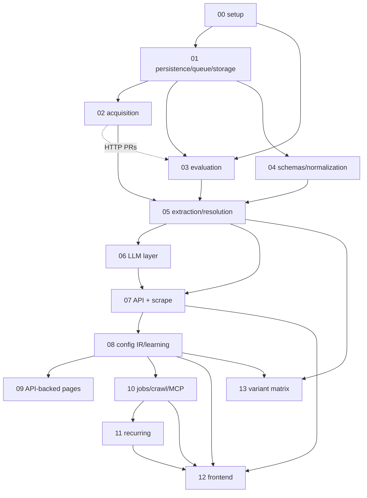

# CrawlerAI v2 — Implementation specs

Written from `docs/ARCHITECTURE.md` rev 4, aligned with rev 5 (the single source of truth), and
`docs/OPEN_QUESTIONS.md`. Each spec follows the same template (summary, scope / out of scope, dependencies,
design, invariants, testing, acceptance, PR plan, open issues). Specs are numbered in implementation order. If a spec changes an
architectural decision, `ARCHITECTURE.md` is updated in the same change.

Nothing in these specs designs a §22 candidate, except SPEC-13, which the owner admitted (Appendix A #37). Where the architecture was under-specified, each spec takes the
most conservative reading, marks additions as "implementation detail, not architecture", and lists the review
finding in its Open issues. Findings that rev 5 resolved are marked "Resolved in ARCHITECTURE rev 5 §…". Choices
marked "Owner to confirm" are agent decisions pending owner confirmation; they are recorded in
`docs/DECISIONS.md` (OPEN_QUESTIONS #14), and implementation state is tracked in `docs/plans/ACTIVE.md`.

## Index

| # | Spec | Architecture sections | Depends on | Layer |
|---|---|---|---|---|
| 00 | [Project setup and engineering foundations](SPEC-00-project-setup.md) | §2 (C1–C13), §4, §18, §19, §21 | — | L0 |
| 01 | [Persistence, job queue and capture storage](SPEC-01-persistence-queue-storage.md) | §4, §6, §15, §17, §19 | 00 | L0 |
| 02 | [Acquisition: HTTP, browser, adapters, politeness, SSRF, captures](SPEC-02-acquisition.md) | §7.1, §7.2 (capture), §15, §18, C3, C6 | 01 | L0 (HTTP) / L1 (browser, adapters) |
| 03 | [Evaluation and measurement](SPEC-03-evaluation-and-measurement.md) | §16, §15, §6 (eval tables), C1, C9, C10, C13, §21 L0 | 00, 01, 02 (PRs 1–3) | L0 |
| 04 | [Schemas as data and type normalization](SPEC-04-schemas-and-normalization.md) | §5, §9, §6 (`schema_def`), C2, C4, C7, C8 | 01 | L1 |
| 05 | [Structured extraction, ownership, resolution and confidence](SPEC-05-extraction-and-resolution.md) | §8.1, §8.2, §8.6, §10, §6, §15, §16.3 | 01, 02, 03, 04 | L1 |
| 06 | [LLM layer: client, grounding, roles C and S](SPEC-06-llm-layer.md) | §11, §8.4, §5.4, §17, §18 | 01, 04, 05 | L1 |
| 07 | [API foundation, auth, content formats and `scrape`](SPEC-07-api-foundation-and-scrape.md) | §13.1 (scrape, schemas, records, replay), §8.5, §18, §3 | 01, 02, 04, 05, 06 | L1 |
| 08 | [Config IR, executor, learning, progressive mode, drift, exporters](SPEC-08-config-ir-learning-progressive.md) | §8.3, §8.4, §12, §13.1 (configs), C5 | 01, 04, 05, 06, 07 | L2 |
| 09 | [API-backed pages: discovery, role D, validation, execution](SPEC-09-api-backed-pages.md) | §7.2, §8.6, §11 (D), §12 | 02, 04, 05, 06, 08 | L2 |
| 10 | [Async jobs, map, crawl frontier, extract, SSE, webhooks, MCP](SPEC-10-jobs-crawl-extract-mcp.md) | §13 (all), §17, §23 | 01, 02, 05, 06, 07, 08 | L3 |
| 11 | [Recurring crawls](SPEC-11-recurring-crawls.md) | §14, §6 (`url_state`, `record`) | 01, 02, 05, 08, 10 | L4 |
| 12 | [Frontend application screens](SPEC-12-frontend-application.md) | §1, §3, §13.1, §5.4, §18, C5 | 00, 03, 07, 08, 10, 11 | L1–L4 |
| 13 | [Variant matrix: per-variant rows from structured data](SPEC-13-variant-matrix.md) | §5.1–§5.3, §8.2 r3, §10, §16, §22 (admitted, Appendix A #37) | 03, 04, 05, 06, 07, 08 | admitted candidate |
| 14 | [Playground workspace: one screen per run, clean JSON, server-side key](SPEC-14-playground-workspace.md) | §1, §3, §12.2, §13.1, §18 (rev 17), Appendix A #38 | 07, 08, 10, 12 | L1–L3 |

Where the labeling tool lives: SPEC-03 (L0), as the first screen of the frontend skeleton from SPEC-00, because
it must exist before any extraction code and is inseparable from the eval store's custodian access model.
SPEC-12 only integrates navigation.

## Dependency graph

Layer mapping (§21): L0 = 00, 01, 02 (PRs 1–5), 03. L1 = 02 (PRs 6–9), 04, 05, 06, 07, 12 (PRs 1–5, 9).
L2 = 08, 09, 12 (PR 6). L3 = 10, 12 (PR 7). L4 = 11, 12 (PR 8).

## Reading order

1. `docs/ARCHITECTURE.md` in full, then `docs/OPEN_QUESTIONS.md`.
2. SPEC-00 (toolchain, CI, invariants, the agent rules in `CLAUDE.md`) — everyone.
3. SPEC-01 → SPEC-02 → SPEC-03 (the L0 measurement layer; nothing in L1 may start before SPEC-03's acceptance
   criteria are met).
4. SPEC-04 → SPEC-05 → SPEC-06 → SPEC-07 (end-to-end extraction; accuracy numbers wait for milestone M, §21).
5. SPEC-08 → SPEC-09 (configs and progressive mode).
6. SPEC-10 → SPEC-11.
7. SPEC-12 alongside the API specs its screens depend on.

Cross-cutting facts fixed by the specs (so later readers do not re-decide them):
- Locator format: SPEC-05 §4.3. Field status values: SPEC-05 §4.2. Label format: SPEC-03 §4.3.
- Schema document rules (ARCHITECTURE §5.2 `scope`, `required_groups`; plus `scheme`, `vocab`): SPEC-04 §4.2.
- Plumbing columns and tables (`job_event`, `record.supersedes_record_id`, `api_key.revoked_at` and
  `webhook_secret`, etc.): SPEC-01 §4.2, which also points to the plumbing added in SPEC-03, -05, -08 and -11.
  Record versions, `url_state.gone_at`/`missing_runs`, the `learn` job kind and the `links_only`/`partial`
  outcomes are architecture (§6), not plumbing.
- Eval store separation (hidden/fresh never in the main DB or main object store): SPEC-01 §4.4, SPEC-03 §4.2.
- Calibration and precedence files are dev-only artifacts stamped with their source split: SPEC-05 §4.9, §4.11.
