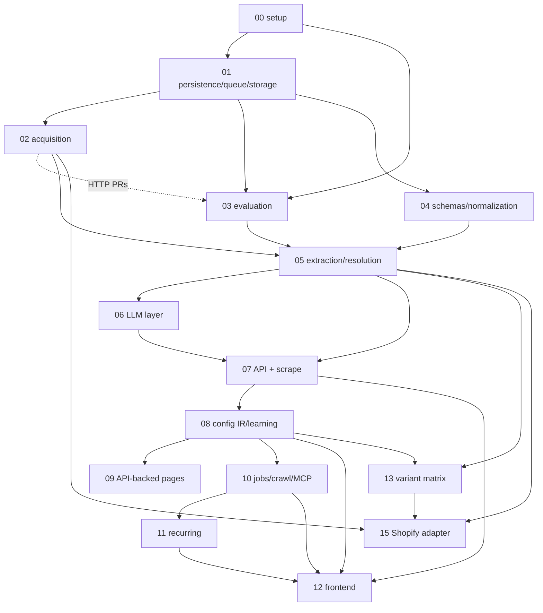

# Archived changes

Done changes, frozen as history. The first sixteen are the original implementation specs (SPEC-00 … SPEC-15),
moved here as-is by the OpenSpec conversion (D-1136) with their decision logs (`decisions.md`); only relative links
were rewritten. Their behaviour now lives in the capability specs under [`../../specs/`](../../specs/). Code comments
and decision entries cite `SPEC-NN §x`: that section is in the spec file below. The folder date is the day the last
PR of the spec merged (SPEC-03: the day it was archived).

A later change is archived by its implementor in the PR that completes it: its deltas are applied to
`openspec/specs/`, then its folder moves here as `<YYYY-MM-DD>-<change-id>/` (`/implement-pr` §5).

## The architecture, rev 26

[2026-10-16-architecture-rev26/ARCHITECTURE.md](2026-10-16-architecture-rev26/ARCHITECTURE.md) is the design
document the specs were written from, frozen at rev 26 by the OpenSpec conversion (D-1136), with
[INVARIANTS.md](2026-10-16-architecture-rev26/INVARIANTS.md), the invariants table of that date. Code comments cite
it as `ARCHITECTURE §N`. Its live parts moved to `../../project.md` (contract C1–C13, §2.2), `../../design/overview.md`
(§1, §2.1, §2.3, §20–§23) and `../../design/owner-decisions.md` (Appendix A); its behaviour lives in `../../specs/`.

## About the original specs

Written from `docs/ARCHITECTURE.md` rev 4, aligned with rev 5 (the single source of truth), and
`docs/OPEN_QUESTIONS.md`. Each spec follows the same template (summary, scope / out of scope, dependencies,
design, invariants, testing, acceptance, PR plan, open issues). Specs are numbered in implementation order. If a spec changes an
architectural decision, `ARCHITECTURE.md` is updated in the same change.

Nothing in these specs designs a §22 candidate, except SPEC-13, which the owner admitted (Appendix A #37). Where the architecture was under-specified, each spec takes the
most conservative reading, marks additions as "implementation detail, not architecture", and lists the review
finding in its Open issues. Findings that rev 5 resolved are marked "Resolved in ARCHITECTURE rev 5 §…". Choices
marked "Owner to confirm" are agent decisions pending owner confirmation; they are recorded in
`docs/DECISIONS.md` (OPEN_QUESTIONS #14), and implementation state is tracked in `docs/plans/ACTIVE.md`.

SPEC-03 is archived with its row 7 open; that row continues in the change
[wire-protected-eval-job](../wire-protected-eval-job/proposal.md). SPEC-13 and SPEC-15 designed admitted §22
candidates (Appendix A #37, #46).

## Index

| # | Spec | Architecture sections | Depends on | Layer | PRs |
|---|---|---|---|---|---|
| 00 | [Project setup and engineering foundations](2026-10-12-spec-00-project-setup/SPEC-00-project-setup.md) ([decisions](2026-10-12-spec-00-project-setup/decisions.md)) | §2 (C1–C13), §4, §18, §19, §21 | — | L0 | PRs 1–10 (#1, #3, #4, #9, #5, #6, #7, #8, #12, #10) |
| 01 | [Persistence, job queue and capture storage](2026-10-13-spec-01-persistence-queue-storage/SPEC-01-persistence-queue-storage.md) ([decisions](2026-10-13-spec-01-persistence-queue-storage/decisions.md)) | §4, §6, §15, §17, §19 | 00 | L0 | PRs 1–8 (#11, #14, #17, #19, #13, #20, #23, #25) |
| 02 | [Acquisition: HTTP, browser, adapters, politeness, SSRF, captures](2026-10-13-spec-02-acquisition/SPEC-02-acquisition.md) ([decisions](2026-10-13-spec-02-acquisition/decisions.md)) | §7.1, §7.2 (capture), §15, §18, C3, C6 | 01 | L0 (HTTP) / L1 (browser, adapters) | PRs 1–10 (#16, #18, #22, #26, #31, #46, #53, #52, #62, #64) |
| 03 | [Evaluation and measurement](2026-10-16-spec-03-evaluation-and-measurement/SPEC-03-evaluation-and-measurement.md) ([decisions](2026-10-16-spec-03-evaluation-and-measurement/decisions.md)) | §16, §15, §6 (eval tables), C1, C9, C10, C13, §21 L0 | 00, 01, 02 (PRs 1–3) | L0 | Rows 1–6 and 8–12 done (#28, #27, #30, #33, #29, #32, #35, #42, #34, #39, #44); row 7 continues in the change [wire-protected-eval-job](../wire-protected-eval-job/proposal.md) |
| 04 | [Schemas as data and type normalization](2026-10-16-spec-04-schemas-and-normalization/SPEC-04-schemas-and-normalization.md) ([decisions](2026-10-16-spec-04-schemas-and-normalization/decisions.md)) | §5, §9, §6 (`schema_def`), C2, C4, C7, C8 | 01 | L1 | PRs 1–12 (#43, #47, #58, #54, #57, #59, #60, #56, #66, #203, #203, #208) |
| 05 | [Structured extraction, ownership, resolution and confidence](2026-10-16-spec-05-extraction-and-resolution/SPEC-05-extraction-and-resolution.md) ([decisions](2026-10-16-spec-05-extraction-and-resolution/decisions.md)) | §8.1, §8.2, §8.6, §10, §6, §15, §16.3 | 01, 02, 03, 04 | L1 | PRs 1–14 (#67, #72, #78, #83, #79, #85, #90, #94, #100, #86, #91, #106, #109, #208) |
| 06 | [LLM layer: client, grounding, roles C and S](2026-10-14-spec-06-llm-layer/SPEC-06-llm-layer.md) ([decisions](2026-10-14-spec-06-llm-layer/decisions.md)) | §11, §8.4, §5.4, §17, §18 | 01, 04, 05 | L1 | PRs 1–7 (#69, #74, #76, #107, #111, #92, #148) |
| 07 | [API foundation, auth, content formats and `scrape`](2026-10-13-spec-07-api-foundation-and-scrape/SPEC-07-api-foundation-and-scrape.md) ([decisions](2026-10-13-spec-07-api-foundation-and-scrape/decisions.md)) | §13.1 (scrape, schemas, records, replay), §8.5, §18, §3 | 01, 02, 04, 05, 06 | L1 | PRs 1–8 (#70, #77, #80, #88, #105, #96, #81, #108) |
| 08 | [Config IR, executor, learning, progressive mode, drift, exporters](2026-10-13-spec-08-config-ir-learning-progressive/SPEC-08-config-ir-learning-progressive.md) ([decisions](2026-10-13-spec-08-config-ir-learning-progressive/decisions.md)) | §8.3, §8.4, §12, §13.1 (configs), C5 | 01, 04, 05, 06, 07 | L2 | PRs 1–12 (#95, #98, #110, #114, #116, #118, #122, #127, #119, #123, #124, #115) |
| 09 | [API-backed pages: discovery, role D, validation, execution](2026-10-13-spec-09-api-backed-pages/SPEC-09-api-backed-pages.md) ([decisions](2026-10-13-spec-09-api-backed-pages/decisions.md)) | §7.2, §8.6, §11 (D), §12 | 02, 04, 05, 06, 08 | L2 | PRs 1–7 (#102, #113, #117, #121, #125, #126, #129) |
| 10 | [Async jobs, map, crawl frontier, extract, SSE, webhooks, MCP](2026-10-14-spec-10-jobs-crawl-extract-mcp/SPEC-10-jobs-crawl-extract-mcp.md) ([decisions](2026-10-14-spec-10-jobs-crawl-extract-mcp/decisions.md)) | §13 (all), §17, §23 | 01, 02, 05, 06, 07, 08 | L3 | PRs 1–10 (#120, #128, #130, #137, #140, #132, #144, #145, #146, #148) |
| 11 | [Recurring crawls](2026-10-14-spec-11-recurring-crawls/SPEC-11-recurring-crawls.md) ([decisions](2026-10-14-spec-11-recurring-crawls/decisions.md)) | §14, §6 (`url_state`, `record`) | 01, 02, 05, 08, 10 | L4 | PRs 1–5 (#131, #135, #136, #142, #139) |
| 12 | [Frontend application screens](2026-10-14-spec-12-frontend-application/SPEC-12-frontend-application.md) ([decisions](2026-10-14-spec-12-frontend-application/decisions.md)) | §1, §3, §13.1, §5.4, §18, C5 | 00, 03, 07, 08, 10, 11 | L1–L4 | PRs 1–11 (#68, #73, #82, #87, #97, #134, #143, #141, #93, #147, #148) |
| 13 | [Variant matrix: per-variant rows from structured data](2026-10-15-spec-13-variant-matrix/SPEC-13-variant-matrix.md) ([decisions](2026-10-15-spec-13-variant-matrix/decisions.md)) | §5.1–§5.3, §8.2 r3, §10, §16, §22 (admitted, Appendix A #37) | 03, 04, 05, 06, 07, 08 | admitted candidate | PRs 1–4 (#170, #172, #171, #174) |
| 14 | [Playground workspace: one screen per run, clean JSON, server-side key](2026-10-16-spec-14-playground-workspace/SPEC-14-playground-workspace.md) ([decisions](2026-10-16-spec-14-playground-workspace/decisions.md)) | §1, §3, §12.2, §13.1, §18 (rev 17), Appendix A #38 | 07, 08, 10, 12 | L1–L3 | PRs 1–11 (#189, #191, #194, #194, #194, #198, #198, #198, #190, #201, #205) |
| 15 | [Shopify adapter: storefront pages through the Storefront API](2026-10-16-spec-15-shopify-adapter/SPEC-15-shopify-adapter.md) ([decisions](2026-10-16-spec-15-shopify-adapter/decisions.md)) | §7.1, §22 (admitted, Appendix A #46), C6 | 02, 05, 13 | admitted candidate | PRs 1–4 (#219, #219, #219, #219) |
| — | [ATS adapters: Workday and Oracle Recruiting Cloud](2026-10-16-ats-adapters/proposal.md) ([tasks](2026-10-16-ats-adapters/tasks.md)) | §7.1, C6 | 02, 15 | L1 (adapters) | tasks 1.1–1.4 (#226) |
| — | [ce1 extraction fixes](2026-10-16-ce1-extraction/proposal.md) ([tasks](2026-10-16-ce1-extraction/tasks.md), [decisions](2026-10-16-ce1-extraction/design.md)) | §8.1, §8.2, §9, §10, Appendix A #48 | 05, 13 | L1 | tasks 1.1–1.9 (#227) |
| — | [Browser waits and client-rendered offers](2026-10-16-ce1-acquisition/proposal.md) ([tasks](2026-10-16-ce1-acquisition/tasks.md), [decisions](2026-10-16-ce1-acquisition/design.md)) | §7.1 | 02 | L1 (acquisition) | tasks 1.1–3.1 (#228) |
| — | [Browser parity with Patchright's documented setup](2026-10-16-browser-parity/proposal.md) ([tasks](2026-10-16-browser-parity/tasks.md), [decisions](2026-10-16-browser-parity/design.md)) | §7.1, Appendix A #50 | 02 | L1 (acquisition) | tasks 1.1–1.4 (#229) |
| — | [Playground follow-ups](2026-10-17-playground-followups/proposal.md) ([tasks](2026-10-17-playground-followups/tasks.md), [decisions](2026-10-17-playground-followups/design.md)) | §13.1, Appendix A #38 | 12, 14 | L1 (frontend) | tasks 1–4 (#238) |
| — | [Fixes from the 40-page site test](2026-10-17-site-test-40-fixes/proposal.md) ([tasks](2026-10-17-site-test-40-fixes/tasks.md), [decisions](2026-10-17-site-test-40-fixes/design.md)) | §8.6, §9 | 04, 05 | L1 | tasks 1.1–4.1 (#240) |
| — | [Listing browser actions](2026-10-17-listing-browser-actions/proposal.md) ([tasks](2026-10-17-listing-browser-actions/tasks.md), [decisions](2026-10-17-listing-browser-actions/design.md)) | §7.1, §8.6, §22, Appendix A #52 | 02, 05, 07, 14 | L1 (acquisition) | tasks 1.1–6.1 (#241) |
| — | [Listing render on no rows](2026-10-17-listing-render-once/proposal.md) ([tasks](2026-10-17-listing-render-once/tasks.md), [decisions](2026-10-17-listing-render-once/design.md)) | §7.1, §8.6, Appendix A #49, #54 | 02, 05 | L1 (acquisition) | tasks 1.1–3.1 (#242) |

Where the labeling tool lives: SPEC-03 (L0), as the first screen of the frontend skeleton from SPEC-00, because
it must exist before any extraction code and is inseparable from the eval store's custodian access model.
SPEC-12 only integrates navigation.

## Dependency graph

Layer mapping (§21): L0 = 00, 01, 02 (PRs 1–5), 03. L1 = 02 (PRs 6–9), 04, 05, 06, 07, 12 (PRs 1–5, 9).
L2 = 08, 09, 12 (PR 6). L3 = 10, 12 (PR 7). L4 = 11, 12 (PR 8).

## Reading order (historical; agents now follow `CLAUDE.md` §1)

1. `docs/ARCHITECTURE.md` in full, then `docs/OPEN_QUESTIONS.md`.
2. SPEC-00 (toolchain, CI, invariants, the agent rules in `CLAUDE.md`) — everyone.
3. SPEC-01 → SPEC-02 → SPEC-03 (the L0 measurement layer; nothing in L1 may start before SPEC-03's acceptance
   criteria are met).
4. SPEC-04 → SPEC-05 → SPEC-06 → SPEC-07 (end-to-end extraction; accuracy numbers wait for milestone M, §21).
5. SPEC-08 → SPEC-09 (configs and progressive mode).
6. SPEC-10 → SPEC-11.
7. SPEC-12 alongside the API specs its screens depend on.

Cross-cutting facts fixed by the specs (so later readers do not re-decide them):
- Locator format: SPEC-05 §4.3. Field status values: SPEC-05 §4.2. Label format: SPEC-03 §4.3.
- Schema document rules (ARCHITECTURE §5.2 `scope`, `required_groups`; plus `scheme`, `vocab`): SPEC-04 §4.2.
- Plumbing columns and tables (`job_event`, `record.supersedes_record_id`, `api_key.revoked_at` and
  `webhook_secret`, etc.): SPEC-01 §4.2, which also points to the plumbing added in SPEC-03, -05, -08 and -11.
  Record versions, `url_state.gone_at`/`missing_runs`, the `learn` job kind and the `links_only`/`partial`
  outcomes are architecture (§6), not plumbing.
- Eval store separation (hidden/fresh never in the main DB or main object store): SPEC-01 §4.4, SPEC-03 §4.2.
- Calibration and precedence files are dev-only artifacts stamped with their source split: SPEC-05 §4.9, §4.11.
| — | [Normalize, collect and content follow-ups](2026-10-17-normalize-collect-content/proposal.md) ([tasks](2026-10-17-normalize-collect-content/tasks.md), [decisions](2026-10-17-normalize-collect-content/design.md)) | §8.5, §8.6, §9 | 04, 05, 07 | L1 | tasks 1.1–1.8 (#245) |
