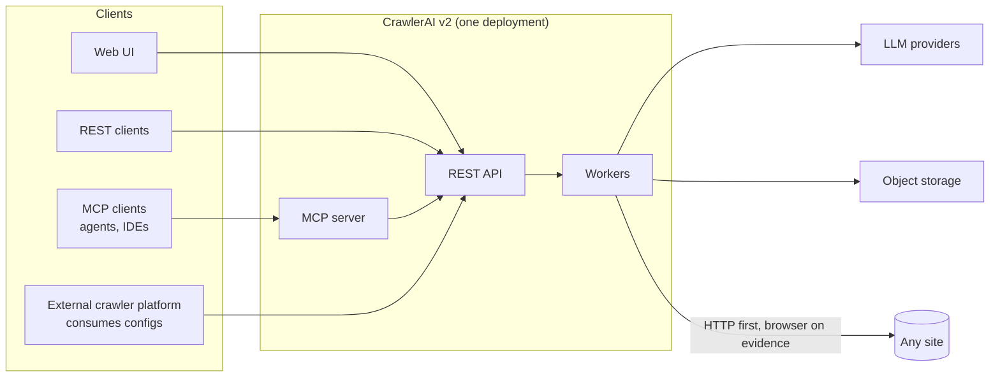
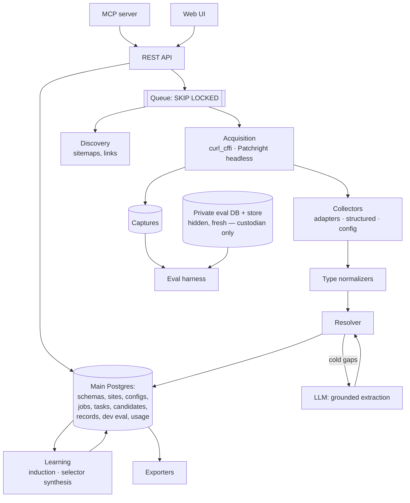

# Overview: goals, context, components

Design rationale, split from the former `docs/ARCHITECTURE.md` with its section numbers kept (code and history cite `ARCHITECTURE §N`). Index: [README.md](README.md).

## 1. Goals and non-goals

**What it is.** It takes any URL or site and returns clean, normalized, typed records for a schema the caller
chooses, plus an executable per-site config. It is used through a REST API, an MCP server and a web UI. The API shapes are
our own. Commerce and jobs are the first schema presets, not the limit. The
project is open source under AGPL-3.0 (Appendix A #26).

**Users** (Appendix B):
- *config users* (crawl and solution engineers) consume configs for an existing crawler platform;
- *data users* consume records;
- agents use it through MCP.

### Goals

| # | Goal | Measured by |
|---|---|---|
| G1 | **Works on sites nobody tuned against.** | Precision and coverage per field type on the **hidden** and **fresh** sets (§16). The gap between dev and fresh results. |
| G2 | **Precision first.** A wrong published value is worse than a missing one. | Required-field precision ≥ 0.97 on hidden. False publishes on `absent` labels ≈ 0. Wrong-product values = 0. |
| G3 | **Any schema.** Callers define a schema, or describe one in a prompt (§5). | Custom schemas use the same pipeline. Accuracy is claimed per schema only after it has labels. |
| G4 | **Records and executable configs** from one pipeline. | Every exported config is re-executed on held-out pages before release (§12). |
| G5 | **Progressive.** The first call on an unknown site works; repeat calls become deterministic and cheap. | Share of pages served by a config. Time from URL to accepted config. |
| G6 | **Recurring crawls are cheap.** Change detection from day one. | LLM calls per 1k recurring pages ≈ 0. |
| G7 | **Replayable.** Any record can be regenerated from its stored capture. | Replay harness in CI. |

Usage (LLM tokens, browser-seconds, proxy bytes) is counted per job for visibility and runaway budgets. An
estimated LLM cost, from the providers' published prices kept as versioned data, is shown for visibility too
(owner, 2026-10-14). There is no billing (Appendix A #2).

### Non-goals

- Page-type detection. The caller chooses detail or listing (§23).
- Web search and scripted browser actions (Appendix A #21).
- Multi-tenant SaaS machinery: billing, signup, tenancy, user accounts, roles. One deployment serves one
  organization, with API keys.
- Enrichment, product intelligence, knowledge graphs.
- Web-scale crawling. The design point is 5k–10k pages/day, with 10× headroom by adding workers.
- Authenticated or paywalled crawls.
- Anything listed in §22, until it is admitted.

## 3. System context

- One deployment, one organization. Projects group sites. Access is by API key.
- REST, MCP and the UI call one service layer; MCP and the UI hold no logic of their own.
- The external platform's config format is unknown (OPEN_QUESTIONS #1). We own a portable config IR (§12) and
  pluggable exporters.

---

## 4. Components

One backend image runs three roles: `api` (REST + MCP over HTTP), `worker` and `scheduler`. Alongside it: one
frontend bundle, Postgres (main plus a private eval database), and object storage (main plus a private root).
There is no Redis and no Celery.
